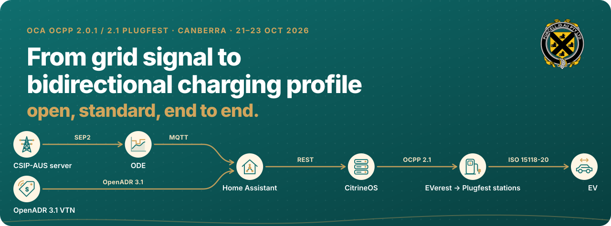
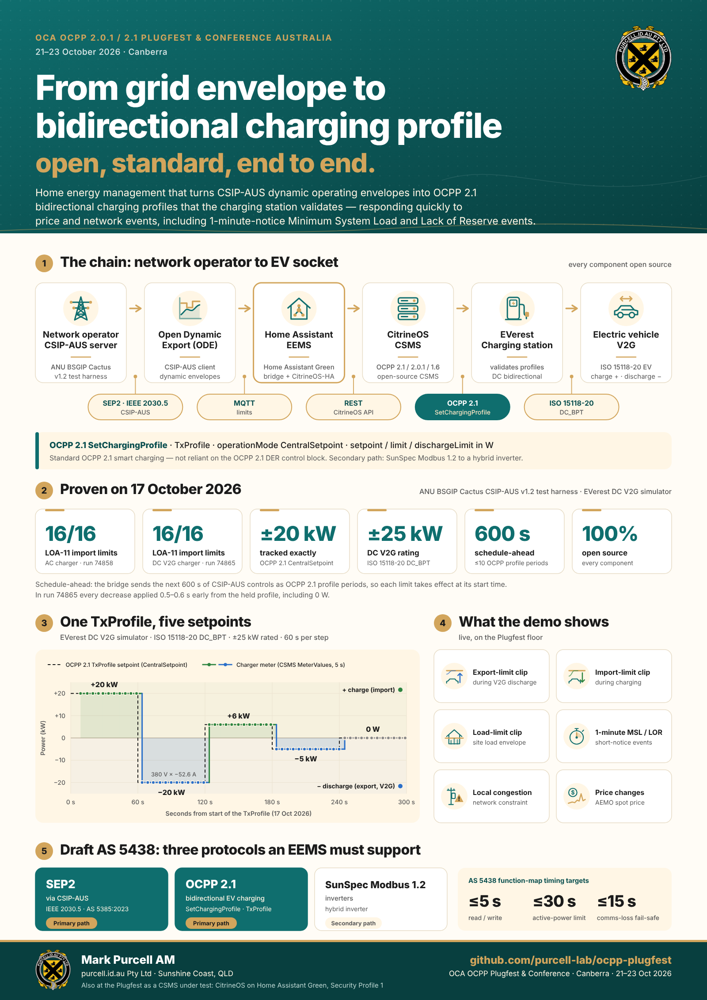
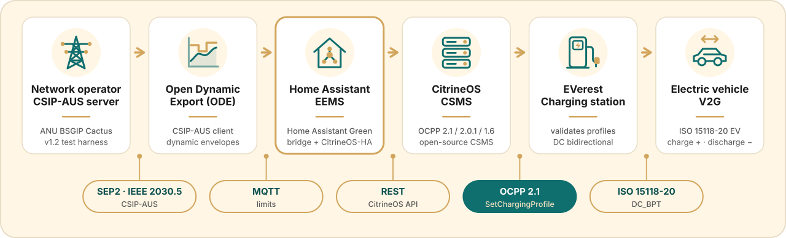
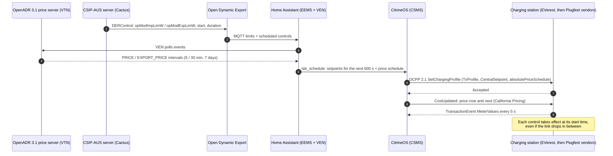
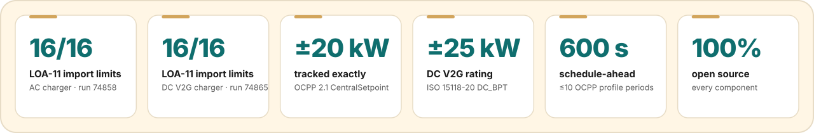
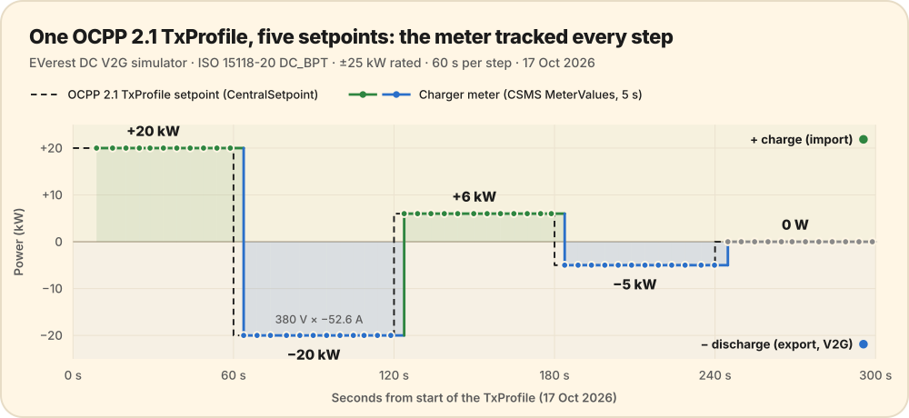
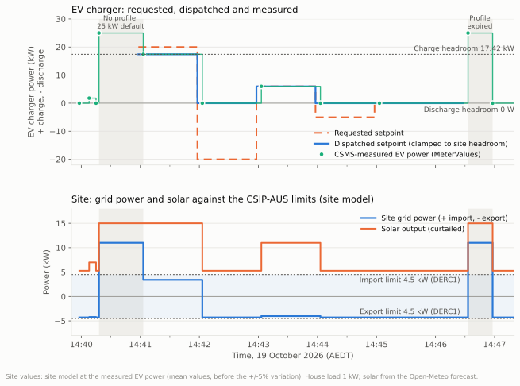
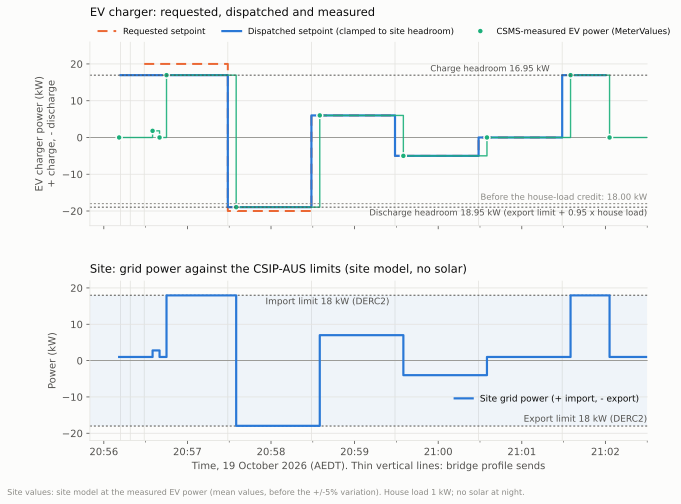
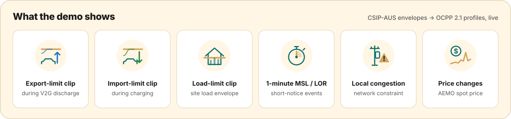
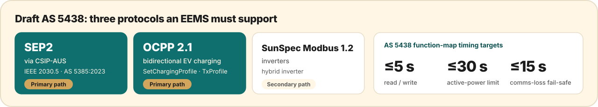

**OCA OCPP Plugfest & Conference Australia · 21–23 October 2026 · Canberra**

> [!IMPORTANT]
> **The idea in one sentence.** A home energy management system takes the network operator's
> **CSIP-AUS dynamic operating envelope** and an **OpenADR 3.1 price signal**, and turns them into
> **OCPP 2.1 bidirectional charging profiles** that a charging station validates and follows, fast
> enough to answer **one-minute-notice network and market events**. The price travels to the station
> with the power. Every link is an open standard, and every component is open source.

### [One-page infographic (PDF)](infographic/plugfest-infographic.pdf) · [Original proposal (PDF)](proposal/purcell_ocpp_plugfest_briefing.pdf) · [Demo script](demo/DEMO.md) · [To-do](TODO.md)

---

## The end-to-end chain

| Hop | Protocol | What happens |
|---|---|---|
| **Network operator → home** | SEP2 / IEEE 2030.5 (AS 5385), **CSIP-AUS v1.2** | The DNSP publishes the household's import, export and load limits and its schedule of controls. Tested against the ANU **Cactus** harness. |
| **CSIP-AUS client** | MQTT | **Open Dynamic Export** (certified CSIP-AUS client) publishes the live limit and the upcoming controls. |
| **Price server → home** | **OpenADR 3.1** `PRICE` / `EXPORT_PRICE` events | An **OpenADR VTN** publishes import and export prices for the household's network tariff, 5- then 30-minute intervals, seven days ahead (from AEMO 7-day pre-dispatch). Home Assistant's **OpenADR VEN** reads them. |
| **EEMS** | REST | **Home Assistant** turns the envelope and the prices into a charging plan: the current setpoint plus the next 600 s, sent ahead of time. |
| **CSMS** | **OCPP 2.1** `SetChargingProfile` | **CitrineOS** sends a TxProfile with `operationMode: CentralSetpoint`, `setpoint`, `limit` and `dischargeLimit` in watts. The price travels with it: an `absolutePriceSchedule` on the profile, `CostUpdated` with the price now and next, and `SetDefaultTariff` for OCPP 2.1 tariffs ([design](design/dynamic-pricing.md)). |
| **Charging station** | **ISO 15118-20 DC_BPT** | The station validates and accepts the profile, then charges or discharges the EV to the setpoint. Before the Plugfest: **EVerest**. At the Plugfest: [vendor stations](#the-charging-stations). |
| **EV** | | Bidirectional: + charging, − discharging (V2G). |

> [!NOTE]
> **No dependency on the OCPP 2.1 DER control block.** Plain OCPP 2.1 smart charging carries the
> bidirectional setpoint, so any OCPP 2.1 station with V2X profile support can take part.

---

## The charging stations

**Before the Plugfest, EVerest is the reference charging station.** Open-source EVerest simulators,
one AC and one DC V2G with ISO 15118-20 DC_BPT, proved the whole chain end to end: every result in
[Proven this week](#proven-this-week) is on EVerest. **At the Plugfest, the same CitrineOS CSMS
meets real vendor stations**, one slot each.

| Stage | Charging station | Type | CSMS endpoint |
|---|---|---|---|
| **Pre‑Plugfest** | **EVerest AC** simulator | OCPP 2.1 (2.0.1 fallback), AC charging | Home lab |
| **Pre‑Plugfest** | **EVerest DC V2G** simulator | OCPP 2.1, ISO 15118-20 DC_BPT, ±25 kW | Home lab |
| Slot 1 | **OCTT (DNV)** | OCPP conformance test tool acting as a station | `ws://purcell.local:8083/<station-id>` |
| Extra | **OCTT (OCA)** | OCPP 2.1 conformance test tool run by the Open Charge Alliance, over the internet ([23 Oct report](results/2026-10-23-octt-oca/README.md)) | `wss://ocpp.purcell.id.au/<station-id>` |
| Extra | **ChargeSim** | Station simulator (ChargeSim SCDE "150kW Single"), OCPP 2.0.1 ([23 Oct report](results/2026-10-23-chargesim/README.md); [Cactus and multi-station record](results/2026-10-23-chargesim-cactus/README.md)) | Plugfest listener, open admission |
| Slot 2 | **EVX Australia** | AC charging station, OCPP 2.0.1 and 1.6J ([slot report](results/2026-10-22-evx-slot2/README.md)) | `ws://purcell.local:8083/<station-id>` |
| Slot 5 | **EVSE** | Charging station | `ws://purcell.local:8083/<station-id>` |
| Slot 6 | **Trialog** | DC V2G charging station, OCPP 2.1 ([slot report](results/2026-10-23-trialog-slot6/README.md)) | `ws://purcell.local:8083/<station-id>` |
| Slot 7 | **AS Jade** | Charging station (online) | `ws://purcell.local:8083/<station-id>` on the venue LAN; remote path to be agreed |
| Slot 10 | **Starcharge** | V2G charging station | `ws://purcell.local:8083/<station-id>` |

Every station uses the same CitrineOS CSMS endpoint (venue LAN), `ws://purcell.local:8083/`, followed by
its own station ID, which is how the CSMS tells stations apart (OCPP 2.1, 2.0.1 and 1.6, Security
Profile 1). If a station can't resolve `purcell.local` (mDNS), use the Green's venue LAN address,
port 8083.

In each slot we run boot, authorisation, transactions and meter values, then the OCPP 2.1 charging
profiles the demonstration sends, and record what each station supports. For a vendor who agrees,
the same chain then controls their charger: **Cactus → Open Dynamic Export → Home Assistant bridge →
CitrineOS → charger**, as V2G setpoints on a bidirectional station (Starcharge) or as charging-only
watt limits on any other. Both paths were rehearsed on the Green with simulators standing in
([rehearsal record](results/2026-10-21-physical-path-rehearsal/README.md)).
→ [Slot runbook](plugfest-lab/RUNBOOK.md) · [Acceptance plan](plugfest-lab/ACCEPTANCE.md)

---

## Proven this week

### OCPP 2.1 bidirectional setpoints on an ISO 15118-20 DC_BPT charger

One OCPP 2.1 TxProfile with five 60-second steps, **+20 → −20 → +6 → −5 → 0 kW**. The charger's
meter, as recorded by the CSMS every 5 s, **matched every step exactly**, each within one meter
sample of its boundary. Discharging at −20 kW ran at 380 V, −52.6 A.
→ [Full result, raw data and station screenshots](results/2026-10-17-v2g-txprofile/README.md)

### The same setpoints under a live network constraint

The same request, sent as a real dispatch while Cactus held the site to **4.5 kW import and
4.5 kW export**. +20 kW was clamped to the 17.42 kW of charge headroom. Both discharge steps
became 0 W, because solar already filled the export limit. The charger followed each dispatched
step exactly, and the site stayed inside both limits while the profile was in force.
→ [Full result, dispatch rule and the no-profile gap](results/2026-10-19-v2g-network-constrained/README.md)

### At night, through the bridge, with house load credited

The same request at night, under **18 kW import and 18 kW export** limits, sent by the ODE
schedule bridge itself. A profile was in force from the transaction start to the stop, so there
was no 25 kW gap. The −20 kW step was clamped to **−18,950 W**: the export limit plus the 1 kW
house load the EV also supplies. The site exported 17.95 kW, inside the limit.
→ [Full result and dispatch](results/2026-10-19-v2g-night-house-load/README.md)

### CSIP-AUS envelopes on the Cactus test harness

| Procedure | Charger | Result | Report |
|---|---|---|---|
| **LOA-11** (CSIP-AUS import limits) | EVerest AC, OCPP 2.1 | **16 / 16 pass** (run 74858) | [LOA-11](cactus/LOA-11/README.md) |
| **LOA-11** (CSIP-AUS import limits) | EVerest DC V2G, OCPP 2.1 | **16 / 16 pass** (run 74865); every decrease applied on time from the held profile, including 0 W | [LOA-11](cactus/LOA-11/README.md) |
| **GEN-10** (primacy validation, generators) | EVerest DC V2G + solar | **46 / 46 pass** (run 75351), after an ODE fix for equal-primacy defaults | [GEN-10](results/2026-10-20-cactus-gen10/README.md) |
| **GEN-11** (variable export limit, 200 % to 0 %) | EVerest DC V2G + solar | **16 / 16 pass, no warnings** (run 75354) | [GEN-11](results/2026-10-20-cactus-gen11/README.md) |
| **ALL-28** (response to changing ramp rates: step, `rampTms`, `setGradW`) | EVerest DC V2G + solar | **15 / 15 steps, no warnings** (run 75360) | [ALL-28](results/2026-10-20-cactus-all28/README.md) |
| **ALL-23** (communication loss: cached schedule, then poll on restore) | EVerest DC V2G + solar | **5 / 5 steps, no warnings** (run 75381, ODE App 0.1.5; run 75362 failed on 0.1.4) | [ALL-23](results/2026-10-20-cactus-all23/README.md) |
| **LOA-10** (primacy validation, loads) | EVerest DC V2G, charging mode | **46 / 46 steps, no warnings** (run 75995); the higher-priority program won every overlap, and the EV covered the house load under 0 W import | [LOA-10](results/2026-10-21-cactus-loa10/README.md) |
| **ALT-ALL-29** (operating telemetry, EVSE alternate) | EVerest DC V2G, charging mode | **All 3 criteria, no warnings** (run 76002): 9 site and 9 DER readings; the EV followed each import step within 30 s | [ALT-ALL-29](results/2026-10-21-cactus-alt-all29/README.md) |
| **ALL-06** (individual readings: site and DER W, var, V; poll timing) | EVerest DC V2G, charging mode | **8 / 8 criteria, no warnings** (run 76007), **but the EV ignored DERC1 (0 W)**: the simulator refused the house-load discharge and kept charging; bridge fix `279a5da` | [ALL-06](results/2026-10-21-cactus-all06/README.md) |
| **ALL-21** (scheduling: 24 one-minute controls) | EVerest DC V2G, discharge (export) mode | **All 6 criteria, no warnings** (run 76139): every control received, started and completed; polls on time; discharge followed each export limit | [ALL-21](results/2026-10-22-cactus-all21/README.md) |
| **ALT-ALL-29** (operating telemetry, EVSE alternate) | **EVSE's Ocular IOCAH39-7S** (vendor charger, OCPP 2.0.1), charging only | **All 3 criteria, no warnings** (run 76307): first end-to-end run with a vendor charger; every TxProfile Accepted, but the charger suspended at 3,580 W (no `numberPhases`, so 3 phases assumed) | [ALT-ALL-29 EVSE](results/2026-10-22-cactus-alt-all29-evse/README.md) |
| ALT-LOA-13 (import limit with a site test load) | EVerest DC V2G, charging mode | Steps complete, no warnings (run 76003), **but the site exceeded 14 kW for ~1.5 min**: the bridge ignored the test load until a mid-run fix (`abf2e89`); within the limit after. Rerun pending | [ALT-LOA-13](results/2026-10-21-cactus-alt-loa13/README.md) |
| ALL-22 (export) | EVerest DC V2G | Run this week; findings being fixed before reruns | [Cactus records](cactus/README.md) |

---

## What the demonstration shows

| Scenario | What you see |
|---|---|
| **V2G under an export limit** | Discharge target clipped by the CSIP-AUS export limit, then released |
| **Charging under an import limit** | CSIP-AUS import steps arrive as profile periods ahead of time and apply on the second |
| **Household load limit** | The charger backs off so the site stays inside the envelope |
| **One-minute notice: Minimum System Load and Lack of Reserve** | Soak up surplus or stop and discharge, delivered before the event starts |
| **Local network congestion** | The charging limit falls with the local constraint |
| **Price events** | An OpenADR 3.1 price event moves the setpoint, travels with the profile as an OCPP 2.1 price schedule, and shows at the station as the price now and next ([design](design/dynamic-pricing.md)) |

→ [Running order, timings and fall-backs](demo/DEMO.md)

---

## Why it matters: draft AS 5438

Draft **AS 5438** *Interoperability Requirements for Inverter Energy Systems* asks an energy management
system to work across **three protocols**: SEP2 (through CSIP-AUS), **OCPP 2.1** for bidirectional
chargers, and SunSpec Modbus. This demonstration is an open reference for the two primary paths,
SEP2 → OCPP 2.1, end to end, with timing evidence against the draft function map
(**≤ 5 s** read/write, **≤ 30 s** active-power limit, **≤ 15 s** communication-loss fail-safe).
Price signals arrive by **OpenADR 3.1**, so the household responds to network limits and market
prices through open standards on every link.

---

## The open-source stack

| Component | Role | Source |
|---|---|---|
| **Open Dynamic Export** | CSIP-AUS client | [longzheng/open-dynamic-export](https://github.com/longzheng/open-dynamic-export) |
| **OpenLEADR** | OpenADR 3.1 price server (VTN), Australian tariff events | [OpenLEADR/openleadr-rs](https://github.com/OpenLEADR/openleadr-rs) (LF Energy) |
| **nem_pd7day** | Sets the VTN prices from AEMO 7-day pre-dispatch and the network tariff | [purcell-lab/nem_pd7day](https://github.com/purcell-lab/nem_pd7day) |
| **Home Assistant** on a Home Assistant Green | EEMS, OpenADR VEN, bridge, dashboards | [home-assistant.io](https://www.home-assistant.io/) |
| **CitrineOS** | CSMS: OCPP 2.1 / 2.0.1 / 1.6 | [citrineos/citrineos-core](https://github.com/citrineos/citrineos-core) |
| **EVerest** | Pre-Plugfest reference charging station: AC and DC V2G (ISO 15118-20) | [EVerest/everest-core](https://github.com/EVerest/everest-core) |
| **Home Assistant Apps** | CitrineOS, EVerest simulators, ODE, MicroOCPP, packaged | [purcell-lab/ha-addons](https://github.com/purcell-lab/ha-addons) |
| **CitrineOS-HA integration** | Home Assistant ↔ CSMS commands and telemetry | [purcell-lab/CitrineOS-HA-Integration](https://github.com/purcell-lab/CitrineOS-HA-Integration) |
| **Cactus** | CSIP-AUS conformance test harness | [ANU BSGIP](https://cactus.cecs.anu.edu.au/) |

---

## Two roles at the Plugfest

| **Demonstration** | **CSMS under test** |
|---|---|
| CSIP-AUS envelope and OpenADR 3.1 prices → OCPP 2.1 bidirectional profile, live, Friday afternoon. | CitrineOS on the Green, Security Profile 1 on the venue LAN, one endpoint, `ws://purcell.local:8083/<station-id>`. [Six vendor slots](#the-charging-stations): OCTT (DNV), EVX Australia, EVSE, Trialog, AS Jade and Starcharge. |
| [Demo script](demo/DEMO.md) · [Infographic](infographic/plugfest-infographic.pdf) | [Runbook](plugfest-lab/RUNBOOK.md) · [Lab records](plugfest-lab/README.md) · [Acceptance plan](plugfest-lab/ACCEPTANCE.md) · [Setup](plugfest-lab/SETUP.md) |

---

## What's in this repository

| Path | Contents |
|---|---|
| [`infographic/`](infographic/) | One-page infographic: PDF, PNG, SVG source |
| [`proposal/`](proposal/README.md) | The July 2026 proposal and what has been built since |
| [`demo/`](demo/DEMO.md) | Demonstration script, scenarios and fall-backs |
| [`design/`](design/dynamic-pricing.md) | Design notes: dynamic electricity prices over OCPP 2.1 |
| [`results/`](results/) | Dated test results with raw data |
| [`cactus/`](cactus/README.md) | Cactus CSIP-AUS test reports, charts and raw controls |
| [`plugfest-lab/`](plugfest-lab/README.md) | CSMS-under-test runbook, setup, acceptance plan, lab records |
| [`TODO.md`](TODO.md) | Plugfest to-do |
| [`assets/`](assets/) | README graphics |

---

**Mark Purcell AM** · purcell.id.au Pty Ltd · Independent energy advisory · Sunshine Coast, QLD
mark@purcell.id.au

Open standards, open source, reproducible evidence.

