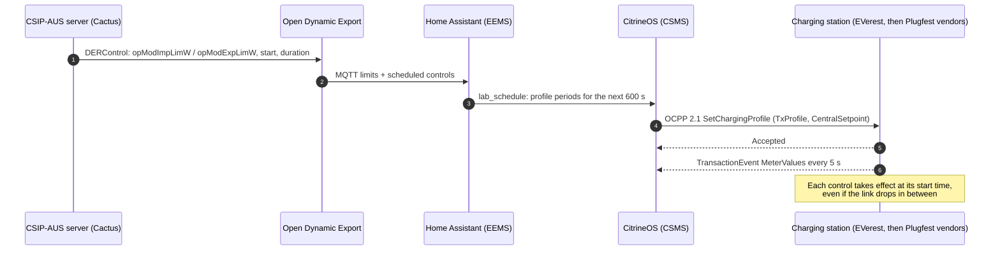

**OCA OCPP Plugfest & Conference Australia · 21–23 October 2026 · Canberra**

> [!IMPORTANT]
> **The idea in one sentence.** A home energy management system takes the network operator's
> **CSIP-AUS dynamic operating envelope** and turns it into **OCPP 2.1 bidirectional charging
> profiles** that a charging station validates and follows, fast enough to answer **one-minute-notice
> network and market events**. Every link is an open standard, and every component is open source.

### [One-page infographic (PDF)](infographic/plugfest-infographic.pdf) · [Original proposal (PDF)](proposal/purcell_ocpp_plugfest_briefing.pdf) · [Demo script](demo/DEMO.md) · [To-do](TODO.md)

---

## The end-to-end chain

| Hop | Protocol | What happens |
|---|---|---|
| **Network operator → home** | SEP2 / IEEE 2030.5 (AS 5385), **CSIP-AUS v1.2** | The DNSP publishes the household's import, export and load limits and its schedule of controls. Tested against the ANU **Cactus** harness. |
| **CSIP-AUS client** | MQTT | **Open Dynamic Export** (certified CSIP-AUS client) publishes the live limit and the upcoming controls. |
| **EEMS** | REST | **Home Assistant** turns the envelope into a charging plan: the current limit plus the next 600 s of controls, sent ahead of time. |
| **CSMS** | **OCPP 2.1** `SetChargingProfile` | **CitrineOS** sends a TxProfile with `operationMode: CentralSetpoint`, `setpoint`, `limit` and `dischargeLimit` in watts. |
| **Charging station** | **ISO 15118-20 DC_BPT** | The station validates and accepts the profile, then charges or discharges the EV to the setpoint. Before the Plugfest: **EVerest**. At the Plugfest: [vendor stations](#the-charging-stations). |
| **EV** | | Bidirectional: + charging, − discharging (V2G). |

> [!NOTE]
> **No dependency on the OCPP 2.1 DER control block.** Plain OCPP 2.1 smart charging carries the
> bidirectional setpoint, so any OCPP 2.1 station with V2X profile support can take part.

---

## The charging stations

**Before the Plugfest, EVerest is the reference charging station.** Open-source EVerest simulators,
one AC and one DC V2G with ISO 15118-20 DC_BPT, proved the whole chain end to end: every result in
[Proven this week](#proven-this-week) is on EVerest. **At the Plugfest, the same CitrineOS CSMS
meets real vendor stations**, one slot each.

| Stage | Charging station | Type | Connection |
|---|---|---|---|
| **Pre‑Plugfest** | **EVerest AC** simulator | OCPP 2.1 (2.0.1 fallback), AC charging | Home lab |
| **Pre‑Plugfest** | **EVerest DC V2G** simulator | OCPP 2.1, ISO 15118-20 DC_BPT, ±25 kW | Home lab |
| Slot 1 | **OCTT (DNV)** | OCPP conformance test tool acting as a station | Venue LAN |
| Slot 2 | **EVX Australia** | Charging station | Venue LAN |
| Slot 5 | **EVSE** | Charging station | Venue LAN |
| Slot 6 | **Trialog** | Charging station | Venue LAN |
| Slot 7 | **AS Jade** | Charging station (online) | Remote: connection path to be agreed |
| Slot 10 | **Starcharge** | Charging station | Venue LAN |

In each slot the station connects to CitrineOS (OCPP 2.1, 2.0.1 or 1.6, Security Profile 1, its own
password). We run boot, authorisation, transactions and meter values, then the OCPP 2.1 charging
profiles the demonstration sends, and record what each station supports.
→ [Slot runbook](plugfest-lab/RUNBOOK.md) · [Acceptance plan](plugfest-lab/ACCEPTANCE.md)

---

## Proven this week

### OCPP 2.1 bidirectional setpoints on an ISO 15118-20 DC_BPT charger

One OCPP 2.1 TxProfile with five 60-second steps, **+20 → −20 → +6 → −5 → 0 kW**. The charger's
meter, as recorded by the CSMS every 5 s, **matched every step exactly**, each within one meter
sample of its boundary. Discharging at −20 kW ran at 380 V, −52.6 A.
→ [Full result, raw data and station screenshots](results/2026-10-17-v2g-txprofile/README.md)

### CSIP-AUS envelopes on the Cactus test harness

| Procedure | Charger | Result | Report |
|---|---|---|---|
| **LOA-11** (CSIP-AUS import limits) | EVerest AC, OCPP 2.1 | **16 / 16 pass** (run 74858) | [LOA-11](cactus/LOA-11/README.md) |
| **LOA-11** (CSIP-AUS import limits) | EVerest DC V2G, OCPP 2.1 | **16 / 16 pass** (run 74865); every decrease applied on time from the held profile, including 0 W | [LOA-11](cactus/LOA-11/README.md) |
| ALL-22, ALT-ALL-29, ALT-LOA-13 (export, readings, load) | EVerest DC V2G | Run this week; findings being fixed before reruns | [Cactus records](cactus/README.md) |

---

## What the demonstration shows

| Scenario | What you see |
|---|---|
| **V2G under an export limit** | Discharge target clipped by the CSIP-AUS export limit, then released |
| **Charging under an import limit** | CSIP-AUS import steps arrive as profile periods ahead of time and apply on the second |
| **Household load limit** | The charger backs off so the site stays inside the envelope |
| **One-minute notice: Minimum System Load and Lack of Reserve** | Soak up surplus or stop and discharge, delivered before the event starts |
| **Local network congestion** | The charging limit falls with the local constraint |
| **Price change** | An OpenADR 3.1 price signal moves the setpoint, travels with the profile as an OCPP 2.1 price schedule, and shows at the station ([design](design/dynamic-pricing.md)) |

→ [Running order, timings and fall-backs](demo/DEMO.md)

---

## Why it matters: draft AS 5438

Draft **AS 5438** *Interoperability Requirements for Inverter Energy Systems* asks an energy management
system to work across **three protocols**: SEP2 (through CSIP-AUS), **OCPP 2.1** for bidirectional
chargers, and SunSpec Modbus. This demonstration is an open reference for the two primary paths,
SEP2 → OCPP 2.1, end to end, with timing evidence against the draft function map
(**≤ 5 s** read/write, **≤ 30 s** active-power limit, **≤ 15 s** communication-loss fail-safe).

---

## The open-source stack

| Component | Role | Source |
|---|---|---|
| **Open Dynamic Export** | CSIP-AUS client | [longzheng/open-dynamic-export](https://github.com/longzheng/open-dynamic-export) |
| **Home Assistant** on a Home Assistant Green | EEMS, bridge, dashboards | [home-assistant.io](https://www.home-assistant.io/) |
| **CitrineOS** | CSMS: OCPP 2.1 / 2.0.1 / 1.6 | [citrineos/citrineos-core](https://github.com/citrineos/citrineos-core) |
| **EVerest** | Pre-Plugfest reference charging station: AC and DC V2G (ISO 15118-20) | [EVerest/everest-core](https://github.com/EVerest/everest-core) |
| **Home Assistant Apps** | CitrineOS, EVerest simulators, ODE, MicroOCPP, packaged | [purcell-lab/ha-addons](https://github.com/purcell-lab/ha-addons) |
| **CitrineOS-HA integration** | Home Assistant ↔ CSMS commands and telemetry | [purcell-lab/CitrineOS-HA-Integration](https://github.com/purcell-lab/CitrineOS-HA-Integration) |
| **Cactus** | CSIP-AUS conformance test harness | [ANU BSGIP](https://cactus.cecs.anu.edu.au/) |

---

## Two roles at the Plugfest

| **Demonstration** | **CSMS under test** |
|---|---|
| CSIP-AUS envelope → OCPP 2.1 bidirectional profile, live, Friday afternoon. | CitrineOS on the Green, Security Profile 1 on the venue LAN, one provisioned password per station. [Six vendor slots](#the-charging-stations): OCTT (DNV), EVX Australia, EVSE, Trialog, AS Jade and Starcharge. |
| [Demo script](demo/DEMO.md) · [Infographic](infographic/plugfest-infographic.pdf) | [Runbook](plugfest-lab/RUNBOOK.md) · [Lab records](plugfest-lab/README.md) · [Acceptance plan](plugfest-lab/ACCEPTANCE.md) · [Setup](plugfest-lab/SETUP.md) |

---

## What's in this repository

| Path | Contents |
|---|---|
| [`infographic/`](infographic/) | One-page infographic: PDF, PNG, SVG source |
| [`proposal/`](proposal/README.md) | The July 2026 proposal and what has been built since |
| [`demo/`](demo/DEMO.md) | Demonstration script, scenarios and fall-backs |
| [`design/`](design/dynamic-pricing.md) | Design notes: dynamic electricity prices over OCPP 2.1 |
| [`results/`](results/) | Dated test results with raw data |
| [`cactus/`](cactus/README.md) | Cactus CSIP-AUS test reports, charts and raw controls |
| [`plugfest-lab/`](plugfest-lab/README.md) | CSMS-under-test runbook, setup, acceptance plan, lab records |
| [`TODO.md`](TODO.md) | Plugfest to-do |
| [`assets/`](assets/) | README graphics |

---

**Mark Purcell AM** · purcell.id.au Pty Ltd · Independent energy advisory · Sunshine Coast, QLD
mark@purcell.id.au

Open standards, open source, reproducible evidence.

