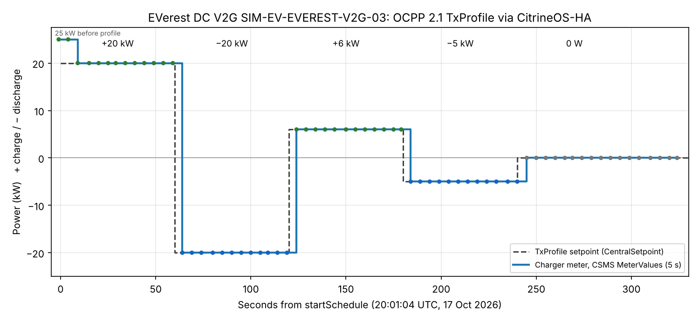
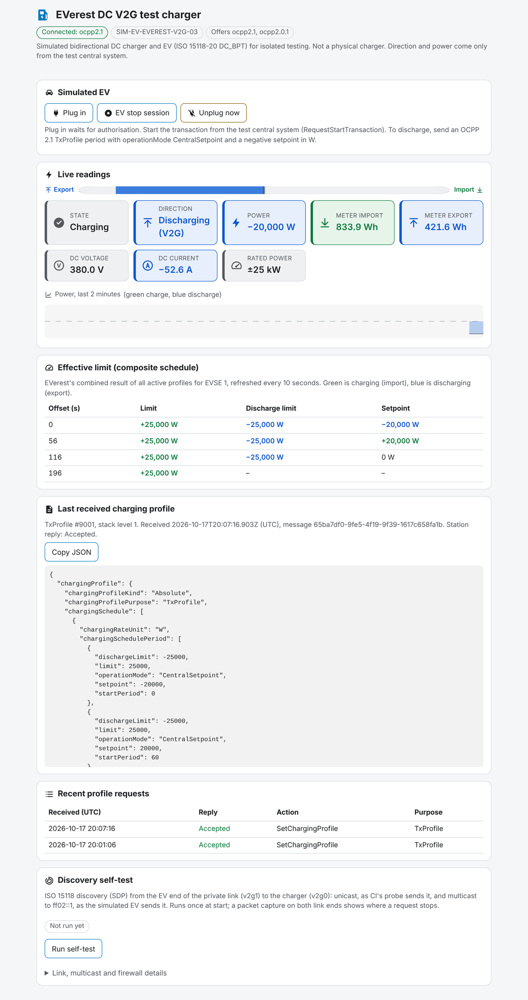
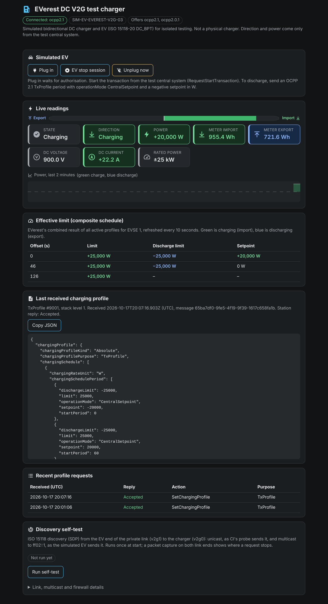

# V2G TxProfile test: OCPP 2.1 CentralSetpoint on an ISO 15118-20 DC_BPT charger

**17 October 2026.** One OCPP 2.1 TxProfile, five 60 s steps (+20, −20, +6, −5, 0 kW), sent by
the Home Assistant integration through CitrineOS to the EVerest DC V2G simulator. The charger
meter, as recorded by the CSMS, matched every step exactly.



## Chain

```
Home Assistant: citrine_ha.lab_schedule (CitrineOS-HA integration)
  └─ CitrineOS Isolated Lab 0.6.2 (CSMS, OCPP 2.1)
       └─ SetChargingProfile: TxProfile, operationMode CentralSetpoint, W
            └─ EVerest DC V2G Test Charger 0.1.9 (SIM-EV-EVEREST-V2G-03, ±25 kW)
                 └─ ISO 15118-20 DC_BPT session with the simulated EV
```

## Profile sent (accepted by the station)

| startPeriod (s) | setpoint | limit | dischargeLimit | operationMode |
|---:|---:|---:|---:|---|
| 0 | **+20,000 W** | 25,000 W | −25,000 W | CentralSetpoint |
| 60 | **−20,000 W** | 25,000 W | −25,000 W | CentralSetpoint |
| 120 | **+6,000 W** | 25,000 W | −25,000 W | CentralSetpoint |
| 180 | **−5,000 W** | 25,000 W | −25,000 W | CentralSetpoint |
| 240 | **0 W** | 25,000 W | −25,000 W | CentralSetpoint |

Full JSON, including `startSchedule` and every CSMS meter sample: [`data.json`](data.json).

## Result

| Step | Setpoint | CSMS MeterValues (5 s) | Home Assistant change (UTC) |
|---|---:|---|---|
| 1 | +20 kW | 12 of 12 samples at +20,000 W | 20:01:15 |
| 2 | −20 kW | 12 of 12 at −20,000 W | 20:02:10 |
| 3 | +6 kW | 12 of 12 at +6,000 W | 20:03:10 |
| 4 | −5 kW | 12 of 12 at −5,000 W | 20:04:10 |
| 5 | 0 kW | every sample 0 W | 20:05:10 |

- Exact values, no overshoot. Each change appeared within one 5 s meter sample of its period
  boundary.
- Discharging at −20 kW: 380 V DC, −52.6 A.
- No OCPP 2.1 DER control block is used: plain OCPP 2.1 smart charging (TxProfile,
  CentralSetpoint) carries the bidirectional setpoint.

## The station during the run

| Discharging −20 kW (V2G) | Charging +20 kW |
|---|---|
|  |  |

The station's own status page (EVerest DC V2G simulator App). The live readings and the
composite schedule are EVerest's; the last received profile is the exact OCPP 2.1 payload.

## Known limits found during this run

- **Reconnect race in CitrineOS v2.0.1**: after a station reconnected, CitrineOS stored the
  station's messages but stopped replying (purcell-lab/ha-addons#67). Fixed by a build-time patch
  in citrineos_server 0.6.3 (purcell-lab/ha-addons#74).
- **Late start**: the simulated EV gives up if RequestStartTransaction arrives about 60 s after
  plug-in (purcell-lab/ha-addons#33). Fixed in the V2G simulator 0.1.10 (purcell-lab/ha-addons#75).
- **Charging voltage** is the EV's 900 V maximum, not the 380 V battery voltage; power is
  correct (purcell-lab/ha-addons#70, deferred: an EvseManager race makes a configuration fix
  unsafe).
