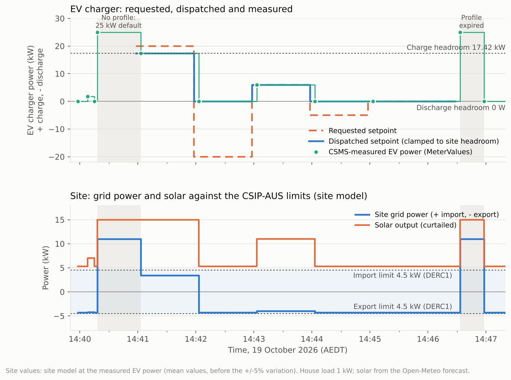

# Network-constrained V2G: OCPP 2.1 setpoints clamped to CSIP-AUS limits

**19 October 2026, 14:40–14:47 AEDT (Canberra).** The same five-step request as the
[17 October TxProfile test](../2026-10-17-v2g-txprofile/README.md) (+20, −20, +6, −5, 0 kW), but
this time sent as a real dispatch under a live network constraint. Each requested setpoint was
clamped to the site's headroom under the CSIP-AUS limits active at the time, then sent as one
OCPP 2.1 CentralSetpoint TxProfile through CitrineOS to the EVerest DC V2G simulator.

The charger followed every dispatched step exactly. The discharge requests had zero headroom, as
expected with solar filling the export limit. Two short windows with no profile in force show the
remaining gap: the station falls back to its full 25 kW.

## Set-up

| | |
|---|---|
| Network constraint | Cactus CSIP-AUS run 75143 (ALL-25-EXT), control DERC1: `opModExpLimW` 4,500 W, `opModImpLimW` 4,500 W, 13:45:34–19:45:34 AEDT, received by Open Dynamic Export |
| CSMS | CitrineOS Isolated Lab 0.7.1 (CitrineOS v2.0.1) on the Green |
| Charger | EVerest DC V2G Test Charger 0.1.11 (`SIM-EV-EVEREST-V2G-03`), ISO 15118-20 DC_BPT, ±25 kW |
| Site (Plugfest mode) | Synthetic site meter: 1 kW house load, solar from the Open-Meteo Solar Forecast for the house arrays (8.5 kWp east, 15 kWp west) at the Green's home location, capped at 15 kW and curtailed so site export stays within the export limit |
| Solar forecast | 15.5 kW until 14:45, then 15.0 kW |

## Dispatch: requested versus sent

Headroom was computed just before sending at 14:40:58 AEDT, with margins for the site's ±5%
variation:

- **Discharge headroom 0 W.** Solar has priority on the export limit and already fills it: even
  curtailed, it exports about 4.3 kW of the 4.5 kW allowed.
- **Charge headroom 17.42 kW.** That is the import limit, plus the least solar expected, minus the
  house load.

| Step | Period (AEDT) | Requested | Dispatched | Why |
|---|---|---:|---:|---|
| 1 | 14:40:58–14:41:58 | +20,000 W | **+17,420 W** | Clamped to the charge headroom |
| 2 | 14:41:58–14:42:58 | −20,000 W | **0 W** | No export headroom |
| 3 | 14:42:58–14:43:58 | +6,000 W | **+6,000 W** | Within headroom |
| 4 | 14:43:58–14:44:58 | −5,000 W | **0 W** | No export headroom |
| 5 | 14:44:58–14:46:28 | 0 W | **0 W** | No change |

Every period also carried `limit` 17,420 W and `dischargeLimit` 0 W. Even if the station held an
old target (the EvseManager race seen on direct reversals), it would stay inside the site limits.

## Result

| Time (AEDT) | CSMS-measured EV power | Site grid power (site model) | Within limits |
|---|---:|---:|:---:|
| 14:40:18 | 25,000 W (no profile yet) | +11.0 kW import | **No** |
| 14:41:03 | 17,420 W | +3.4 kW import | Yes |
| 14:42:03 | 0 W | −4.3 kW export | Yes |
| 14:43:03 | 6,000 W | −4.0 kW export | Yes |
| 14:44:03 | 0 W | −4.3 kW export | Yes |
| 14:46:33 | 25,000 W (profile expired 14:46:28) | +11.0 kW import | **No** |
| 14:46:58 | 0 W (transaction stopped) | −4.3 kW export | Yes |

- **The dispatch was followed exactly.** All five dispatched values appear unchanged in the CSMS
  MeterValues, each change within one 5-second meter sample of its period boundary (about 5 s
  later).
- **Within the profile, the site stayed inside both limits.** Charging at 17.42 kW drew 3.4 kW
  from the grid against a 4.5 kW import limit. Every other step kept the site's export at the
  limit.
- **Charging the EV makes room for solar.** During the 6 kW step, curtailed solar rose from 5.3 kW
  to 11 kW: the EV absorbed what would otherwise have been exported above the limit.
- **Discharge was correctly withheld.** Both discharge requests (−20 kW and −5 kW) became 0 W.
  With solar already exporting at the limit, V2G export would have broken the export limit.

## Gap found: no profile, full power

For 45 s after the transaction started (14:40:18–14:41:03) and 25 s after the profile expired
(14:46:33–14:46:58), no charging profile was in force. In both windows the station charged at its
25 kW default, and the site imported about 11 kW against the 4.5 kW limit.

In this test both windows came from the procedure. The ODE schedule bridge, which normally sends a
600 s profile and renews it every 60 s, was paused so that it would not replace the test profile.
After the test the bridge was turned back on. To close the gap for any session:

1. **Send the limit with the start.** OCPP 2.x RequestStartTransaction can carry a
   `chargingProfile`. Alternatively, keep a `TxDefaultProfile` installed at the current headroom,
   so a new transaction never starts unlimited.
2. **Never let a profile lapse.** Renew it well before it expires (the bridge already does this).
   Or fall back to a TxDefaultProfile at the headroom rather than to no profile.

## Before the test: stale transaction fixed

The first attempt was blocked: CitrineOS still listed a transaction from 18 October as active,
because an App update had recreated the simulator mid-session. CitrineOS 0.7.1
([purcell-lab/ha-addons#79](https://github.com/purcell-lab/ha-addons/pull/79)) now asks the
station with OCPP GetTransactionStatus. Within a minute of starting on the Green, it closed the
stale transaction (`not ongoing at the station`), and the session above started normally.

## Other observation

CitrineOS v2.0.1 on the Green ran out of JavaScript heap (the App sets 768 MB) about 15 minutes
after each start, three times on 19 October. This test ran in a freshly started process. The cause
is not yet known.

## Data and method

- [`PROCEDURE.md`](PROCEDURE.md) is the step-by-step procedure: how the test profile was sent
  with the ODE schedule bridge paused so it was not overwritten, and what to change next time.
- [`data.json`](data.json) holds the constraint, the dispatch rule, the profile sent, the CSMS
  meter samples and the event times, all in AEDT.
- [`make_chart.py`](make_chart.py) renders the chart: `python3 make_chart.py`, which needs
  matplotlib.
- The site values are **computed, not measured**. They come from the site model at the
  CSMS-measured EV power, using mean values before the ±5% random variation. The live site meter
  is published on MQTT every 10 s and is not recorded in Home Assistant.
