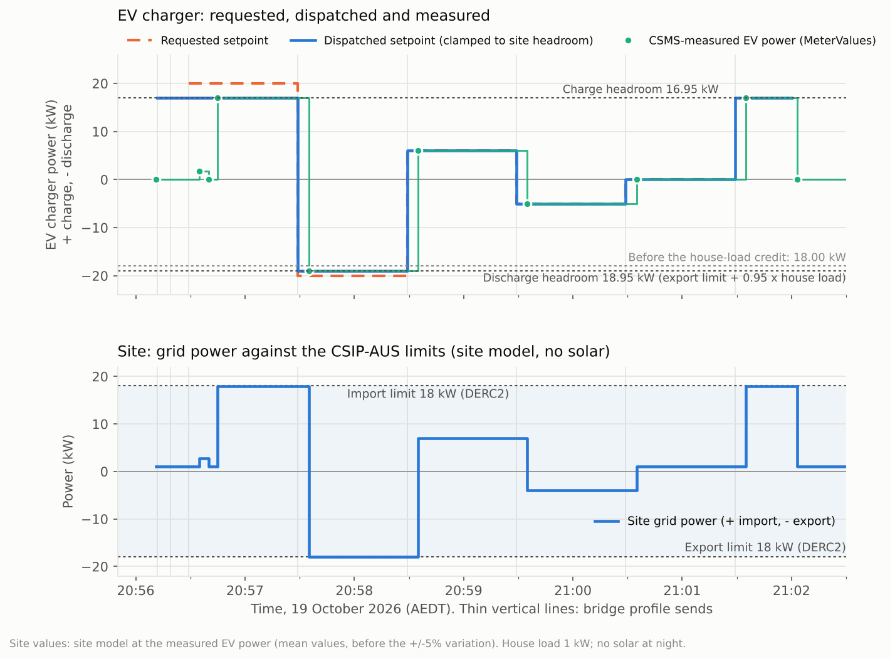

# Night-time V2G through the bridge: discharge headroom credits the house load

**19 October 2026, 20:56–21:02 AEDT (Canberra).** The same five-step request as the
[afternoon network-constrained test](../2026-10-19-v2g-network-constrained/README.md)
(+20, −20, +6, −5, 0 kW), run at night under Cactus control DERC2 (18 kW import, 18 kW export).
This time the ODE schedule bridge stayed on and added the steps to its own TxProfile, so a profile
was in force from the transaction start to the stop.

It is the first run with the bridge change in commit `ef0ca44`. The discharge headroom now counts
house load that solar doesn't cover, because that load absorbs discharge before it reaches the grid.
With no solar and 1 kW of house load, the −20 kW step was clamped to **−18,950 W**: the 18 kW
export limit plus 0.95 × the house load. Before the change it would have been −18,000 W.

## Set-up

| | |
|---|---|
| Network constraint | Cactus CSIP-AUS run 75143 (ALL-25-EXT), control DERC2: `opModImpLimW` 18,000 W, `opModExpLimW` 18,000 W, active since 19:45:34 AEDT, received by Open Dynamic Export |
| CSMS | CitrineOS Isolated Lab 0.7.1 (CitrineOS v2.0.1) on the Green, CitrineOS-HA integration 0.6.1 |
| Charger | EVerest DC V2G Test Charger 0.1.12 (`SIM-EV-EVEREST-V2G-03`), ISO 15118-20 DC_BPT, ±25 kW |
| Dispatch | ODE schedule bridge ([`bridge_automation.yaml`](../../plugfest-lab/ha/bridge_automation.yaml) at `ef0ca44`), steps from [`script.lab_v2g_txprofile_test`](../../plugfest-lab/ha/txprofile_test_script.yaml) with its defaults: 60 s steps, starting 10 s after the call |
| Price | Each profile carried the OpenADR NSW1 Essential import price schedule; the test did not change it |
| Site (Plugfest mode) | Synthetic site meter: 1 kW house load, no Cactus test load, solar from the Open-Meteo forecast for the 10 kW system: 0 W at night |

## Dispatch: requested versus sent

The bridge clamps each step to the headroom of its period, with margins for the site's ±5%
variation:

- **Charge headroom 16,950 W:** the import limit, plus 0.95 × solar, minus 1.05 × the house load:
  18,000 + 0 − 1,050.
- **Discharge headroom 18,950 W:** the export limit, minus (1.05 × solar − 0.95 × the house load):
  18,000 − (0 − 950).

| Step | Period (AEDT) | Requested | Dispatched | Measured | Why |
|---|---|---:|---:|---:|---|
| Before | 20:56:12–20:56:29 | n/a | +16,950 W | ramping up | Import mode: the bridge's profile from the transaction start |
| 1 | 20:56:29–20:57:29 | +20,000 W | **+16,950 W** | +16,950 W from 20:56:45 | Clamped to the charge headroom |
| 2 | 20:57:29–20:58:29 | −20,000 W | **−18,950 W** | −18,950 W from 20:57:35 | Clamped to the discharge headroom, now including the house load |
| 3 | 20:58:29–20:59:29 | +6,000 W | **+6,000 W** | +6,000 W from 20:58:35 | Within headroom |
| 4 | 20:59:29–21:00:29 | −5,000 W | **−5,000 W** | −5,000 W from 20:59:35 | Within headroom |
| 5 | 21:00:29–21:01:29 | 0 W | **0 W** | 0 W from 21:00:35 | No change |
| After | 21:01:29–21:02:03 | n/a | +16,950 W | +16,950 W from 21:01:35 | Test over: import mode again; stopped at 21:02:00 |

## Result

| Time (AEDT) | CSMS-measured EV power | Site grid power (site model) | Within limits |
|---|---:|---:|:---:|
| 20:56:45 | +16,950 W | +17.95 kW import | Yes |
| 20:57:35 | −18,950 W | −17.95 kW export | Yes |
| 20:58:35 | +6,000 W | +7.0 kW import | Yes |
| 20:59:35 | −5,000 W | −4.0 kW export | Yes |
| 21:00:35 | 0 W | +1.0 kW import | Yes |
| 21:01:35 | +16,950 W | +17.95 kW import | Yes |
| 21:02:03 | 0 W (transaction closed) | +1.0 kW import | Yes |

- **The dispatch was followed exactly.** Every dispatched value appears unchanged in the CSMS
  MeterValues, each about 6 s after its boundary: one meter sample.
- **The house-load credit worked as designed.** At −18,950 W the EV covered the 1 kW house load
  and exported 17.95 kW, inside the 18 kW export limit. At the low end of the ±5% variation
  (950 W of house load) the export is exactly 18,000 W, which is why the credit uses 0.95.
- **No profile gap.** The afternoon test paused the bridge and had two windows with no profile in
  force. Here the bridge sent a profile as soon as the transaction started (20:56:12) and a new
  one at every step boundary. The charger never ran at its 25 kW default.
- **Start-up ramp.** The EV read 1,800 W at 20:56:35, then 0 W at 20:56:40, before reaching
  16,950 W at 20:56:45. This is the simulator's DC start-up (cable check and pre-charge), all
  below the profile's limit.
- **One missing reading.** The measured-power sensor read "unknown" for about 1 s at 21:00:00,
  between two −5,000 W samples. The charger's power did not change.

## Data and method

- [`data.json`](data.json) holds the constraint, the dispatch rule and headroom, the steps sent,
  the bridge send times, the CSMS meter samples and the event times, all in AEDT.
- [`make_chart.py`](make_chart.py) renders the chart: `python3 make_chart.py`, which needs
  matplotlib.
- The site values are **computed, not measured**. They are the house load plus the CSMS-measured
  EV power, using mean values before the ±5% random variation. The live site meter is published
  on MQTT every 10 s and is not recorded in Home Assistant.
- How to repeat it: [`plugfest-lab/ha/README.md`](../../plugfest-lab/ha/README.md#the-bridge)
  (start the session, then run `script.lab_v2g_txprofile_test`). The bridge stays on; the
  [afternoon procedure](../2026-10-19-v2g-network-constrained/PROCEDURE.md) of pausing it is no
  longer needed.
