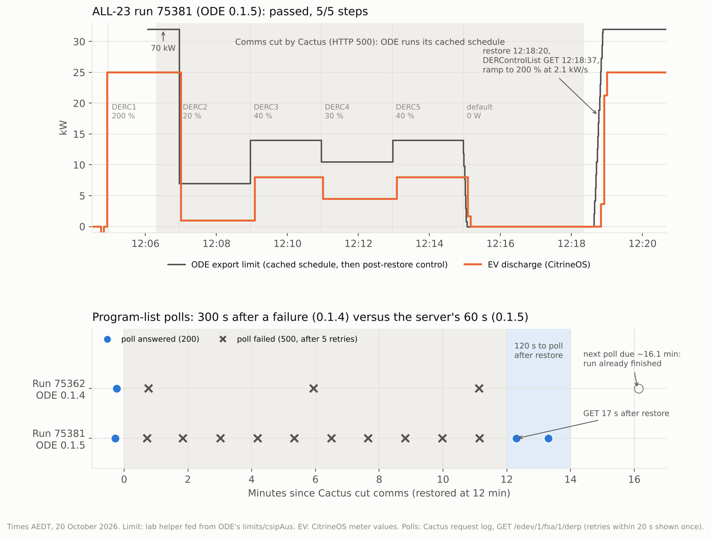

# Cactus ALL-23 (communication loss): run 75381 passed, after an ODE polling fix

**20 October 2026, Canberra (AEDT).** Cactus CSIP-AUS procedure ALL-23, classes A and DR-A. Two runs:

| Run | Time (AEDT) | Client | Result |
|---|---|---|---|
| 75362 | 10:06–10:21 | Open Dynamic Export App 0.1.4 | **Failed: 4 / 5 steps.** `GET-DERC-AFTER-COMMS-RESTORE` not completed |
| 75381 | 12:04–12:20 | Open Dynamic Export App **0.1.5** | **Passed: 5 / 5 steps.** The criterion and both precondition checks passed, with no warnings |

ALL-23 checks that the client keeps following the schedule it already has when the server goes away.
It then checks that the client picks up new controls once the server returns.

1. **Schedule:** Cactus sets a 0 W default (with `setGradW` 600, 6 %/s) and five back-to-back 2-minute
   controls: 200 %, 20 %, 40 %, 30 % and 40 % of the site's 35 kW rating.
2. **Outage:** 10 s after the client fetches the default, every request gets HTTP 500 "COMMS DISABLED"
   for 12 minutes. The client should run DERC1–5 and then fall back to 0 W.
3. **Restore:** Cactus restores comms and creates a new 200 % control. The client must then fetch the
   DERControlList within **120 s**.

## Set-up

| | |
|---|---|
| CSIP-AUS client | Open Dynamic Export App on the Green: 0.1.4 for run 75362, 0.1.5 for run 75381 |
| DER | Synthetic solar, `inverters/1` (the Open-Meteo forecast for a 10 kW system, about 5–6 kW) |
| | The EVerest DC V2G simulator `SIM-EV-EVEREST-V2G-03`, `inverters/4`, rated 25 kW. It runs via CitrineOS and the ODE schedule bridge in export mode, with a 25 kW discharge target and solar priority |
| Site | Synthetic meter: 1 kW house load + solar + EV |

## Run 75362: the schedule held, the restore was missed

**During the outage ODE did everything right.** It had fetched the default and all five controls in
one poll at 10:07:33, 14 s before the cut.

- It switched controls on time: 70 kW, then 7 kW at 10:08:56, 14 kW at 10:10:56, 10.5 kW at 10:12:57
  and 14 kW at 10:14:57.
- At 10:16:56 it ramped to the 0 W default at 2.1 kW/s, reaching 0 at 10:17:02.
- The V2G EV followed each step within about 6 s.

**It missed the restore.** Cactus restored comms at 10:19:47, but ODE didn't poll the program list again
before the run finished at 10:21:47.

| Program-list poll (AEDT) | Result |
|---|---|
| 10:07:33 | 200 |
| 10:08:33 | 500 |
| 10:13:44 | 500, **5 minutes** later |
| 10:18:55 | 500, 52 s before the restore |
| about 10:23:55 | next poll due, two minutes after the run finished |

**Cause:** ODE v0.20.0's `PollableResource` schedules the next poll from the response's `pollRate`.
When a poll fails it has no response, so it falls back to ODE's built-in default, 300 s for the CSIP-AUS
lists. After the first failed poll every list moved onto a 5-minute cycle. That isn't a Cactus quirk: a
real utility server outage would leave ODE up to 5 minutes late seeing new controls.

## The fix: ODE App 0.1.5

`poll-rate-after-error.patch`:
- **After a failure:** `PollableResource` keeps the poll rate of the last successful response, here
  the server's 60 s, and uses it after a failed poll.
- **Before the first success:** the 300 s default is used only until the first successful poll.
- **Tests:** two new tests. The outage test fails on unpatched v0.20.0.
- **Tracking:** shipped in [purcell-lab/ha-addons#84](https://github.com/purcell-lab/ha-addons/pull/84).
  Raising it upstream is tracked in [purcell-lab/ha-addons#85](https://github.com/purcell-lab/ha-addons/issues/85).

## Run 75381: passed

| Step | Cactus (AEDT) | What ODE did |
|---|---|---|
| Run start, DERC1 200 % (70 kW) | 12:04:57 | Restarted at about 12:05:57, after its first poll found no limits; applied 70 kW at 12:06:04. The EV had been discharging 25 kW since 12:04:55 |
| (a, b) `GET-DEFAULT-DERC` | 12:06:03 | Fetched the default and DERC1–5 in the same poll |
| (c) Comms cut | 12:06:19 | Polls failed from 12:07:02 |
| (d) DERC2 20 % | 12:06:57 | 7 kW; EV −0.97 kW at 12:07:00 (solar takes its share first) |
| DERC3 40 % | 12:08:57 | 14 kW; EV −7.97 kW at 12:09:05 |
| DERC4 30 % | 12:10:57 | 10.5 kW; EV −4.47 kW at 12:11:00 |
| DERC5 40 % | 12:12:58 | 14 kW; EV −7.97 kW at 12:13:05 |
| (e) Back to the 0 W default | 12:14:57 | Ramped at 2.1 kW/s (`setGradW` 600), 0 at 12:15:03; EV 0 at 12:15:10 |
| Program-list polls during the outage | | **Every 60–70 s** (60 s plus about 10 s of HTTP retries): 12:07:02, 12:08:10, … 12:17:28, all 500 |
| (f) Comms restored, new 200 % control | 12:18:20 | |
| (f) `GET-DERC-AFTER-COMMS-RESTORE` | **12:18:37** | **17 s after the restore.** Received and Started for the new control at 12:18:38–39. Ramped 0 → 70 kW at 2.1 kW/s, 12:18:38 to 12:19:11. EV back to −25 kW at 12:19:00 |
| Run finished | 12:20:20 | |

## Other observations

None of these are assessed by ALL-23.

- **Responses during the outage are lost.**
  - **What happened:** ODE retried each Started and Completed response 5 times while comms were down
    (Cactus logged them as 500s), then dropped it.
  - **After the restore:** ODE doesn't re-send them, so Cactus never received the Started responses
    for DERC2–5 or the Completed responses for DERC1–5.
  - **Why it matters:** CSIP-AUS expects responses to be delivered when the server returns. Worth an
    upstream issue.
- **No readings during the outage.** ODE posted no 60 s MirrorMeterReadings while comms were down and
  doesn't backfill them, so the site and DER series in [`data.json`](data.json) have gaps.
- **After the run.**
  - **This run:** once Cactus marked it finished (HTTP 410 Gone), ODE 0.1.5 polled about once a minute,
    with no retries.
  - **Run 75362:** after that run ODE kept posting DERStatus and readings several times a second.
- **A stale response at the start.** When ODE was restarted before run 75381 (12:03), it posted a
  Received response for run 75362's controls before the new run had loaded. The run started at
  12:04:57, so this didn't affect it.
- **The EV session had to be restarted.** The V2G simulator's session ended at 11:17 after an
  authorisation timeout. The EV was unplugged, plugged in again and started at 12:04:24, before the run.

## Data and method

- [`data.json`](data.json) holds, for both runs and all in AEDT:
  - the steps and results;
  - ODE's live export limit;
  - the EV's measured power;
  - the program-list polls from the Cactus request log;
  - ODE's posted site and DER readings;
  - ODE's responses.

  It has no site identifiers.
- [`make_chart.py`](make_chart.py) renders the chart: `python3 make_chart.py`, which needs
  matplotlib.
- ODE's limit is the lab helper `input_number.lab_ode_export_limit`, fed from ODE's `limits/csipAus`
  topic.
- The EV's power is the CSMS-measured value from CitrineOS, through the CitrineOS-HA integration.
- The raw Cactus artifacts aren't committed, because they carry the site's identifiers.
