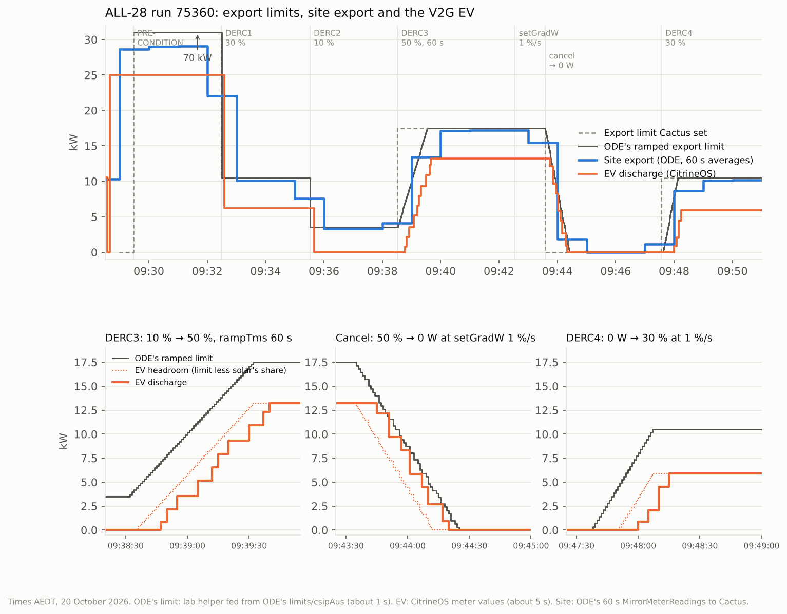

# Cactus ALL-28 (response to changing ramp rates): run 75360 passed

**20 October 2026, 09:28–09:57 AEDT (Canberra).** Cactus CSIP-AUS procedure ALL-28, class DER-A, run
75360: **15 / 15 steps complete**. The criterion and both precondition checks passed, with **no warnings**.

ALL-28 is one of the tests the Plugfest organisers say clients find hardest. It checks that the client
ramps between limits in three different ways:
- **a step** between two controls;
- **the control's own ramp time**, `rampTms`;
- **the default control's ramp rate**, `setGradW`, which the test changes partway through.

Every control sets the import and export limits to the same percentage of the site's rating. Cactus
used **35 kW** for both `maxExportW` and `maxImportW`, the `setMaxW` ODE reports (10 kW solar + 25 kW V2G
charger). So 50 % is 17.5 kW, 30 % is 10.5 kW and 10 % is 3.5 kW.

## Set-up

| | |
|---|---|
| CSIP-AUS client | Open Dynamic Export App 0.1.4 on the Green (restarted at 09:15 before the run) |
| DER | Synthetic solar, `inverters/1`: the Open-Meteo forecast for a 10 kW system, 4.7–5.3 kW during the run |
| | The EVerest DC V2G simulator `SIM-EV-EVEREST-V2G-03`, `inverters/4`, rated 25 kW. It runs via CitrineOS and the ODE schedule bridge in export mode, with a 25 kW discharge target and solar priority |
| Site | Synthetic meter: 1 kW house load + solar + EV |
| Bridge | [`bridge_automation.yaml`](../../plugfest-lab/ha/bridge_automation.yaml) at `5bca1c0`: no ramp logic of its own. It follows ODE's live, already-ramped limit |

## Steps, controls and ODE's responses

| Step (TS 5573) | Cactus (AEDT) | Control | What ODE did |
|---|---|---|---|
| Precondition | 09:29:28 | 200 % (70 kW), 240 s | Received and Started 09:29:29–30. The EV discharged its full 25 kW |
| Precondition | 09:32:29 | DERC1, 30 % (10.5 kW) | Started 09:32:30; precondition Superseded. **Step**, no ramp |
| (a, b) | 09:35:31 | DERC2, 10 % (3.5 kW) | Started 09:35:32; DERC1 Superseded. **Step**: the EV was at 0 by 09:35:40, **9 s** after Cactus created it (limit 15 s) |
| (c, d) | 09:38:31 | DERC3, 50 % (17.5 kW), `rampTms` 60 s | Started 09:38:33; DERC2 Superseded. **Ramped 09:38:32 → 09:39:32 at 230 W/s**: 14 kW in exactly 60 s |
| (e) | 09:42:33 | Default updated: `setGradW` 100 (1 %/s), 0 W | ODE picked it up at 09:42:34 |
| (f, g) | 09:42:34 | Check: DERSettings `setGradW` 100 | **ODE sent DERSettings with `setGradW` 100 at 09:42:34.4, 0.5 s later. Passed** |
| (h) | 09:43:35 | Cactus cancels the active controls | Check: **Cancelled response for DERC3 at 09:43:35. Passed** |
| (i) | 09:43:35 | Back to the 0 W default at 1 %/s | **Ramped 09:43:35 → 09:44:25 at 350 W/s**: 17.5 kW to 0 in 50 s |
| (j, l) | 09:47:34 | DERC4, 30 % (10.5 kW), 300 s | **Ramped 09:47:38 → 09:48:07 at 350 W/s**: 0 to 10.5 kW in 30 s |
| (k) | 09:47:38 | Check: Started response for DERC4 | **Started at 09:47:38, 4 s after Cactus created DERC4. Passed** |
| End | 09:50:36 | Last step complete | DERC4 Completed at 09:52:34 |

**The ramp rates ODE applied:**
- **Between two controls it steps.** DERC1 and DERC2 went from one control straight to the next.
- **With `rampTms` it ramps over that time,** both up and down. DERC3's 60 s took 3.5 → 17.5 kW at
  a steady 230 W/s.
- **Moving to or from the default, it ramps at the default's `setGradW`.** The rate is a percentage
  of the 35 kW nameplate, so 1 %/s is 350 W/s: 50 s for the fall to 0, 30 s for the rise to 30 %.
  Before step (e) the default had no `setGradW`, so ODE would have used 16.67 %/min, but no step
  in this run moved to or from the default before then.

## How the site followed

The zoomed panels show ODE's ramped limit, the EV's headroom under it (the limit less solar's share,
as the bridge works it out) and the EV's measured discharge.

- **Ramps up (DERC3 and DERC4):**
  - the EV started once the limit passed solar's share of about 4.3 kW;
  - it then climbed in steps of about 1.4 kW every 3–10 s, 8–15 s behind ODE's ramp, never above
    its headroom;
  - site export, solar first and then the EV, followed the ramp from below.
- **Ramp down (step i):**
  - the EV stepped down every 3–6 s, about 5–7 s behind ODE's limit, so for about 40 s it ran up to
    about 3 kW above its solar-priority share;
  - the site stayed within the limit, because the synthetic solar curtails to whatever the export
    limit leaves after the EV (`pv_cap` in the synthetic site automation);
  - so during the fall, solar gave up its priority for a few seconds at a time;
  - ODE's 60 s site averages (15.5 kW, then 1.9 kW) match the average of the ramping limit over
    each minute.
- **Steps (DERC1, DERC2):** the EV changed within one meter sample of ODE, 5–8 s after Cactus.
- **Profile sends:** the bridge sent a new profile about every second during the fall, the rate that
  drew an HTTP 500 from CitrineOS in LOA-11. The EV's power shows no stalls or jumps back up, so
  each one went through.

Before ODE's first poll in the run (09:28:59–09:29:30), it had not yet fetched the 0 W default, and
the site exported about 29 kW. That window was before any step started, and ALL-28 doesn't assess it.

## Findings

| Finding | Detail | Change |
|---|---|---|
| **ODE meets ALL-28 on its own** | The step, `rampTms` and `setGradW` cases are all in ODE's `ControlLimitRampHelper`. ODE also re-sends DERSettings when the default's `setGradW` changes | None |
| **The EV trails ODE's ramp by 5–15 s** | The bridge sends increases at most every 5 s, and the charger takes about 5 s to follow a new profile. On the way down this costs solar its priority for a few seconds | Proposed: the bridge reads ODE's `setGradW` and the active control's `rampTms`, and sends the whole ramp as one profile of 6–10 s steps that never goes above ODE's ramp |
| **One profile a second on ramps down** | A fall of more than 50 W is sent at once, so a 50 s ramp means about 50 profiles | Removed by the same change |
| **DERC1 got two closing responses** | Superseded at 09:35:32, then Cancelled at 09:43:35 when Cactus cancelled all active controls. The same pattern as DERC 8 in [GEN-10](../2026-10-20-cactus-gen10/README.md). ALL-28 checks only the latest response for DERC3 | None |

## Data and method

- [`data.json`](data.json) holds, all in AEDT:
  - the result and the step times;
  - ODE's live export limit, about once a second while it changed;
  - the EV's measured power;
  - ODE's posted site and DER readings (60 s averages, labelled at the end of each window);
  - ODE's responses.

  It has no site identifiers.
- [`make_chart.py`](make_chart.py) renders the chart: `python3 make_chart.py`, which needs
  matplotlib.
- ODE's limit comes from the lab helper `input_number.lab_ode_export_limit`. It is fed from ODE's
  `limits/csipAus` topic, which carries the already-ramped value.
- The EV's power is the CSMS-measured value from CitrineOS, through the CitrineOS-HA integration.
- The raw Cactus artifacts aren't committed, because they carry the site's identifiers.
