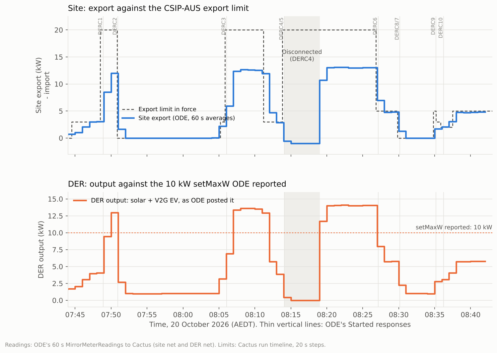

# Cactus GEN-10 (primacy validation, generators): run 75351 passed

**20 October 2026, 07:44–08:42 AEDT (Canberra).** Cactus CSIP-AUS procedure GEN-10, class DER-G, run
75351: **46 / 46 steps complete**, all requests XSD-valid. One warning: 88 DER readings above the
DER's `setMaxW`, from a lab configuration gap that is now fixed (below).

GEN-10 checks that the client applies controls and defaults by **program primacy**. It sets up two
function set assignments:
- **FSA 1:** five programs at primacy 1. Only DERP 1 has a default control.
- **FSA 2:** ten programs at primacy 2. DERP 6 carries most of the controls.

Through ten controls (DERC 1–10) it checks:
- that the higher-priority program wins;
- that superseded controls are reported as Superseded;
- that the client falls back to the right default when no control is active.

## Set-up

| | |
|---|---|
| CSIP-AUS client | Open Dynamic Export App **0.1.4** on the Green (ODE v0.20.0 plus `default-control-merge.patch`, [purcell-lab/ha-addons#82](https://github.com/purcell-lab/ha-addons/pull/82)) |
| DER | Synthetic solar, `inverters/1`: the Open-Meteo forecast for a 10 kW system, curtailed to ODE's limits |
| | The EVerest DC V2G simulator `SIM-EV-EVEREST-V2G-03`, `inverters/4`, via CitrineOS and the ODE schedule bridge in export mode: an 11 kW discharge target, solar priority from 07:50 |
| Site | Synthetic meter: 1 kW house load + solar + EV |
| Rating reported | `setMaxW` 10 kW, the solar nameplate only (see warning) |

## Why the earlier run failed and this one passed

Run 75349 (07:24 AEDT) was stopped after the first step. ODE v0.20.0 used the default control of
the **first** program at the lowest primacy. GEN-10 lists the five primacy-1 programs as DERP 5, 4,
3, 2, 1, and only DERP 1 has a default. So ODE took DERP 5's empty default and applied no limit
instead of 30 %.

The 0.1.4 patch takes each control from the highest-priority default that sets it. In run 75351 ODE
applied DERP 1's 3,000 W export / 0 W import default from 07:45, and every default step passed:
- (b) the 30 % default;
- (l) the 30 % default again after DERC 3;
- (ee) the updated 50 % default.

The fix is tracked for upstream in
[purcell-lab/ha-addons#83](https://github.com/purcell-lab/ha-addons/issues/83).

## Controls and ODE's responses

| Control (program) | What it sets | Started (AEDT) | Ended |
|---|---|---|---|
| Default (DERP 1) | 30 % export (3 kW), 0 W import | 07:44:50 fetched | Updated to 50 % at 08:37:14 |
| DERC 1 (DERP 6) | 200 % export (20 kW) | 07:48:54 | Superseded 07:50:56 |
| DERC 2 (DERP 1) | 0 W export | 07:50:56 | Completed 08:04:54 |
| DERC 3 (DERP 6) | 200 % export | 08:06:04 | Completed 08:10:54 |
| DERC 4 (DERP 1) | Disconnect, 0 W generation | 08:14:05 | Completed 08:19:01 |
| DERC 5 (DERP 6) | 200 % export, 20 min | 08:14:07 | Superseded 08:27:07 |
| DERC 6 (DERP 6) | 50 % export | 08:27:08 | Superseded 08:30:09 (by DERC 8) |
| DERC 7 (DERP 1) | 0 W export | 08:30:14 | Completed 08:35:08 |
| DERC 8 (DERP 6) | 50 % export, 30 % generation | 08:30:10 | Superseded 08:30:13 (when DERC 7 started), then Completed 08:35:03 |
| DERC 9 (DERP 1) | 50 % generation | 08:35:12 | Cancelled 08:37:16 |
| DERC 10 (DERP 6) | 20 % export | 08:36:15 | Cancelled 08:37:16 |

Every Started, Superseded and Completed response the procedure asks for was posted within about a
second of the control's start or end. At 08:37:14 Cactus cancelled all active controls and set the
updated defaults: DERP 1 at 50 %, DERP 6 at 20 %. ODE reported the cancellations at 08:37:16 and
followed DERP 1's 50 %, the higher priority.

**Two response quirks, not checked by GEN-10:**
- **DERC 8:** ODE sent two closing responses for it, Superseded and then Completed. DERC 7 overrides
  only its export limit, not its generation limit.
- **DERC 8 and DERC 10:** Started arrived a few milliseconds before Received.

## Limits held

The chart's top panel plots the site export ODE posted to Cactus against the limit in force.

**New controls applied at once:**
- **DERC 2 at 07:50:56 (20 kW down to 0 W):** the EV stopped at 07:51:00, 4 s later.
- **DERC 6 and DERC 7:** the same, within one meter sample.

**Falling back to a default ramps:** when a control ends and ODE drops back to a lower default, it
ramps its limit down at the default control's `setGradW` (1.67 % of 10 kW per second, about
167 W/s). After DERC 3 ended at 08:10:54, site export took about 2 minutes to fall from 12.6 kW to
the 3 kW default. That is how ODE implements the CSIP-AUS ramp rate, and Cactus passed it.

**During DERC 4 (disconnect):** solar and the EV were at 0 W, and the site imported its 1 kW house
load. DERP 1's default also sets a 0 W **import** limit, which no site with an uncontrollable load
can meet while disconnected. GEN-10 doesn't assess import.

## Findings and what changed

| Finding | Cause | Change |
|---|---|---|
| **88 DER readings above `setMaxW`** (the only warning) | `inverters/4` (the V2G charger) published nameplate `maxW` 0, so ODE reported `setMaxW` 10 kW, while the DER (solar plus EV) reached 14 kW | The readings automation now publishes the charger's 25 kW. ODE reports `setMaxW` 35 kW (ocpp-plugfest 4294c62) |
| **Step (q): no 60 s reconnect delay or ramp** | When DERC 4 ended (08:19:01) the EV went to 11 kW in 4 s, and solar went straight to full output. ODE leaves the AS/NZS 4777.2 reconnection to the inverter, and the lab's "inverters" (the bridge and the synthetic site) didn't do it | The bridge and the synthetic site now hold output at 0 for 60 s after a reconnect, then ramp at WGra, 16.67 % of rating per minute (ocpp-plugfest 4294c62). Not yet seen on a reconnection |
| **Cactus "Site Power" reads double** | Cactus plots the site net plus the three phases, which sum to net. For example, at 08:22 ODE posted −13,097 W and Cactus plotted −26,194 W | Reporting only; to raise with the Cactus team. This record uses ODE's posted readings |
| **ODE timestamps 60 s averages at the window end** | Each `MirrorMeterReading` `timePeriod.start` is the end of the averaging window. The EV's 07:49:01–07:49:50 ramp shows in the value labelled 07:50, and its 07:51:00 stop from the value labelled 07:52 | The chart draws each average over the minute before its timestamp. Worth checking against IEEE 2030.5, where `start` is the start of the interval |
| **Export mode let the EV crowd out solar** | Until 07:50 the bridge gave the EV the whole export limit, and ODE curtailed solar | Export mode now gives solar priority (ocpp-plugfest 35ebbe5) |

## Data and method

- [`data.json`](data.json) holds, all in AEDT:
  - the result, checks and warning;
  - ODE's posted site and DER readings (60 s averages);
  - Cactus's limit timeline, in 20 s steps;
  - every matched step with its request time.

  It has no site identifiers.
- [`make_chart.py`](make_chart.py) renders the chart: `python3 make_chart.py`, which needs
  matplotlib.
- The full Cactus artifacts (database dumps, request logs, PDF report) aren't committed, because
  they carry the site's identifiers.
- Re-run GEN-10 with the 25 kW nameplate and the reconnection soft start. Step (q) should then
  show the 60 s wait and the ramp, and the `setMaxW` warning should be gone. With `setMaxW` at
  35 kW, the percentage limits scale up (30 % becomes about 10.5 kW).
