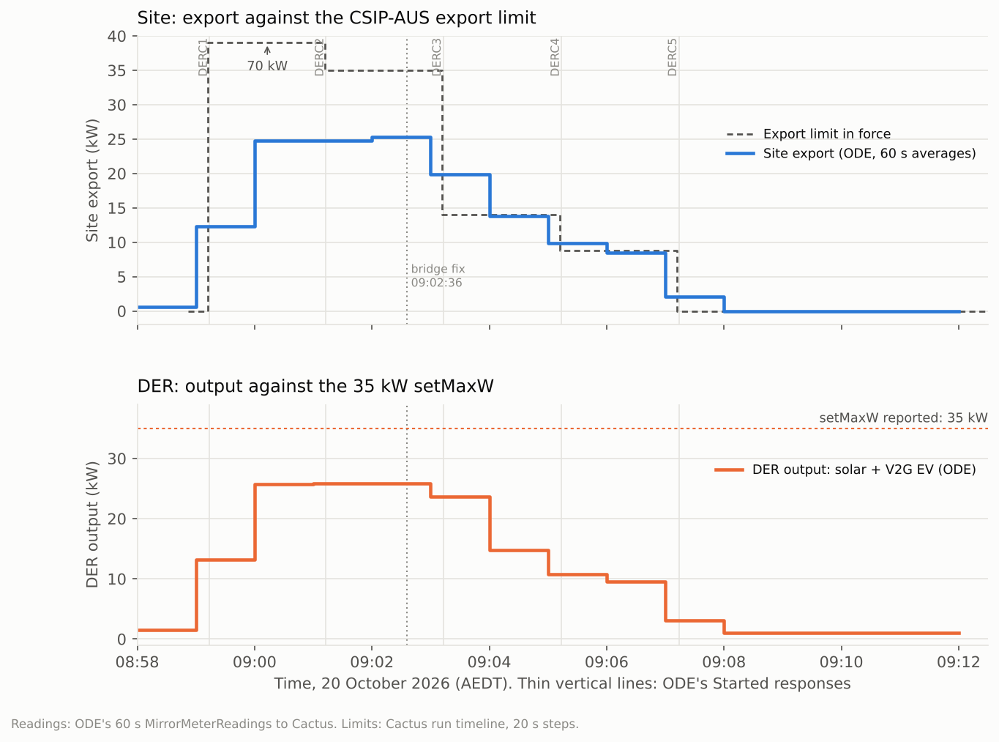

# Cactus GEN-11 (variable export limit, generators): run 75354 passed

**20 October 2026, 08:58–09:12 AEDT (Canberra).** Cactus CSIP-AUS procedure GEN-11, class DER-G, run
75354: **all 16 checks passed, no warnings**:
- the one step;
- Received, Started and Completed for each of the five controls.

GEN-11 sets a 0 W default, then five back-to-back 2-minute export limits: 200 %, 100 %, 40 %, 25 % and
0 % of the site's `maxExportW`. Here `maxExportW` was **35 kW**, the `setMaxW` ODE reported after the
GEN-10 fix (10 kW solar + 25 kW V2G charger).

## Set-up

| | |
|---|---|
| CSIP-AUS client | Open Dynamic Export App 0.1.4 on the Green (restarted at 08:57 before the run) |
| DER | Synthetic solar, `inverters/1`: about 4.3 kW of a 10 kW system |
| | The EVerest DC V2G simulator `SIM-EV-EVEREST-V2G-03`, `inverters/4`, rated 25 kW. It runs via CitrineOS and the ODE schedule bridge in export mode, with a 25 kW discharge target and solar priority |
| Site | Synthetic meter: 1 kW house load + solar + EV |
| Rating reported | `setMaxW` 35 kW |

## Controls and ODE's responses

| Control | Export limit | Received | Started | Completed |
|---|---|---|---|---|
| Default | 0 W, `setGradW` 600 | (fetched 08:59:13) | | |
| DERC 1 | 200 % = 70 kW | 08:59:15 | 08:59:14 | 09:01:14 |
| DERC 2 | 100 % = 35 kW | 08:59:14 | 09:01:13 | 09:03:13 |
| DERC 3 | 40 % = 14 kW | 08:59:14 | 09:03:13 | 09:05:14 |
| DERC 4 | 25 % = 8.75 kW | 08:59:14 | 09:05:14 | 09:07:14 |
| DERC 5 | 0 W | 08:59:15 | 09:07:14 | 09:09:15 |

Cactus created all five controls when ODE fetched the program list at 08:59:13. ODE posted every
Started and Completed response within a second of each 2-minute boundary. DERC 1's Started arrived
a millisecond before its Received, the same ordering quirk seen in GEN-10; GEN-11 checks only that
each response is present.

## Limits held

ODE's 60 s averages (each covers the minute before its timestamp):

| Minute (AEDT) | Limit in force | Site export | DER output |
|---|---|---|---|
| 09:00–09:01 | 70 kW | 24.7 kW | 25.8 kW |
| 09:02–09:03 | 35 kW | 25.3 kW | (not posted) |
| 09:04–09:05 | 14 kW | **13.8 kW** | 14.8 kW |
| 09:06–09:07 | 8.75 kW | **8.5 kW** | 9.5 kW |
| 09:08–09:12 | 0 W | **0 W** | 1.0 kW (solar covering the house load) |

**Within limits:** inside every control's window the site stayed under the limit; the EV was cut back
at each step and solar kept its share. The minutes that straddle a boundary (09:03, 09:05, 09:07)
average the two limits.

**The one minute above a limit, 08:58–08:59 (0.6 kW of export against the 0 W default):** Cactus
only started the run at 08:58:52, so most of that minute came before the run and the default
existed. The next minute shows the 0 W default followed by DERC 1.

## Finding: the bridge clipped the export ceiling at the charger's rating

During DERC 1 and DERC 2 the EV discharged **21.4 kW instead of its 25 kW target**. The bridge
clipped ODE's export ceiling to the charger's 25 kW *before* taking off solar's share, so it worked
out 25,000 − (1.05 × 4,301 − 0.95 × 1,000) ≈ 21,430 W.

The fix takes solar's share off the real ceiling, then caps the discharge at 25 kW
(ocpp-plugfest 5bca1c0, with a regression test that reproduces the 21,430 W). It was deployed during
the run at **09:02:36**, and the EV reached 25 kW at 09:02:42.

Both limits (70 kW and 35 kW) were far above the site's output either way, so compliance wasn't
affected. The fix is marked on the chart.

## Next

The bridge's 25 kW charger rating, and the `inverters/4` nameplate, are still fixed values. Work is
under way to read each charger's rated power (OCPP device model `EVSE.Power`) and the EV's limits
(`NotifyEVChargingNeeds`) from CitrineOS, so they update automatically for other chargers at the
Plugfest.

## Data and method

- [`data.json`](data.json) holds, all in AEDT:
  - the result;
  - ODE's posted site and DER readings (60 s averages, labelled at the end of each window);
  - Cactus's limit timeline, in 20 s steps;
  - ODE's responses.

  It has no site identifiers.
- [`make_chart.py`](make_chart.py) renders the chart: `python3 make_chart.py`, which needs
  matplotlib.
- Cactus plots "Site Power" at twice the net ODE posts (see the
  [GEN-10 record](../2026-10-20-cactus-gen10/README.md)), so this record uses ODE's posted readings.
  The raw Cactus artifacts aren't committed.
