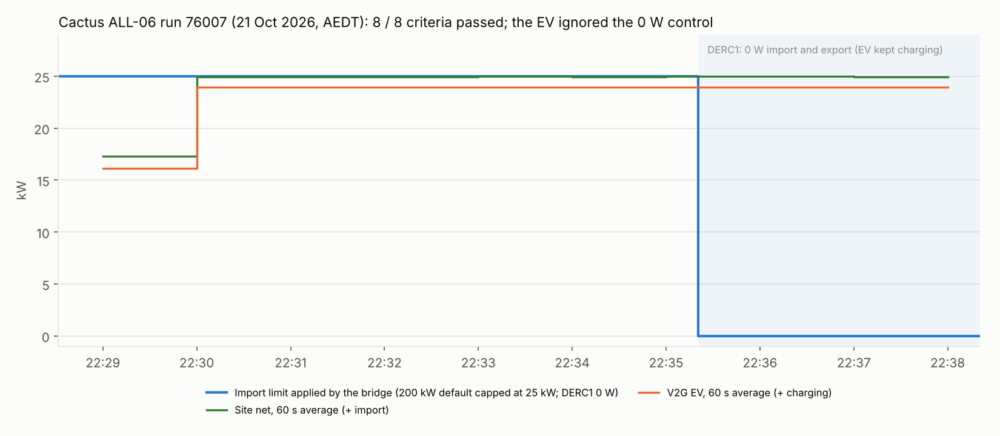

# Cactus ALL-06 (individual readings): run 76007 passed, EV did not follow the 0 W control

**21 October 2026, 22:28:31–22:38:20 AEDT.** Cactus CSIP-AUS procedure ALL-06, classes A / DR-A, run 76007:
**all eight criteria passed, no warnings**.

| Criterion | Result |
|---|---|
| `all-steps-complete` | Passed (4 / 4 steps) |
| `readings-site-active-power`, at least 6 | Passed: 9 readings (net and three phases) |
| `readings-site-reactive-power`, at least 6 | Passed: 9 readings (about 330 var) |
| `readings-voltage`, at least 6 | Passed: 9 readings per phase (225–236 V) |
| `readings-der-active-power`, at least 6 | Passed: 9 readings |
| `readings-der-reactive-power`, at least 6 | Passed: 9 readings (0 var) |
| `all-polls-at-correct-time` (60 s) | Passed for `/dcap`, `/edev`, `/edev/1/fsa`, `/edev/1/der`, `/edev/1/fsa/1/derp`, `/edev/1/derp/1/dderc`, `/mup` |
| `all-requests-xsd-valid` | Passed |

ALL-06 checks monitoring only: 200 kW default import and export limits, then DERC1 (0 W import and export) for
the last three minutes. It does not score the readings against the limits.

## Set-up

| | |
|---|---|
| CSIP-AUS client | Open Dynamic Export App 0.1.5 on the Green, restarted before the run |
| CSMS and charger | CitrineOS 0.7.3, CitrineOS-HA 0.6.2, EVerest DC V2G simulator 0.1.13 (`SIM-EV-EVEREST-V2G-03`, 25 kW) |
| Bridge | [`bridge_automation.yaml`](../../plugfest-lab/ha/bridge_automation.yaml) at `abf2e89`, **charging (import) mode**, house load 1 kW |
| Test load | Not used; the procedure's 25 % test-load instruction is not scored |

## Finding: the EV did not follow DERC1

The bridge applied the 200 kW default (capped at the 25 kW rating) at 22:29:16 and the EV charged at 23.95 kW.
DERC1 (0 W import and export) started at 22:35:20 and the bridge sent its profile at 22:35:24: 0 W charge plus a
−950 W discharge to cover the 1 kW house load. The simulator accepted every profile but kept charging at 23.95 kW
until the run ended (the imported-energy meter rose at about 24 kW throughout), so the site imported about 25 kW
against a 0 W limit.

**Cause.** The simulator logged `Bidirectional export back to grid requested, but not supported.` In EVerest
2025.10.0 (`EvseManager` `energy_grid` limits) a discharge request on a session that is not ISO 15118-20 DC_BPT is
only logged: the new limit is not applied, so the previous charge limit stays. The same plug-in session had
discharged at −950 W earlier in the evening (LOA-10, ALT-ALL-29); why it stopped accepting discharge is not yet
known.

**Fix** (`279a5da`). If the EV still charges above 500 W 30 s after a discharge setpoint, the bridge latches the
transaction in `input_text.lab_bridge_discharge_refused` and sends no discharge for it, so a 0 W import limit stops
the EV. The simulator was re-plugged after the run for a fresh session.

## Files

| File | |
|---|---|
| `data.json` | Cactus summary and check results, the readings ODE posted, the timeline data streams (no device identifiers) |
| `make_chart.py` | Renders `all06-chart.png` / `.svg` from `data.json`: `python3 make_chart.py` |
