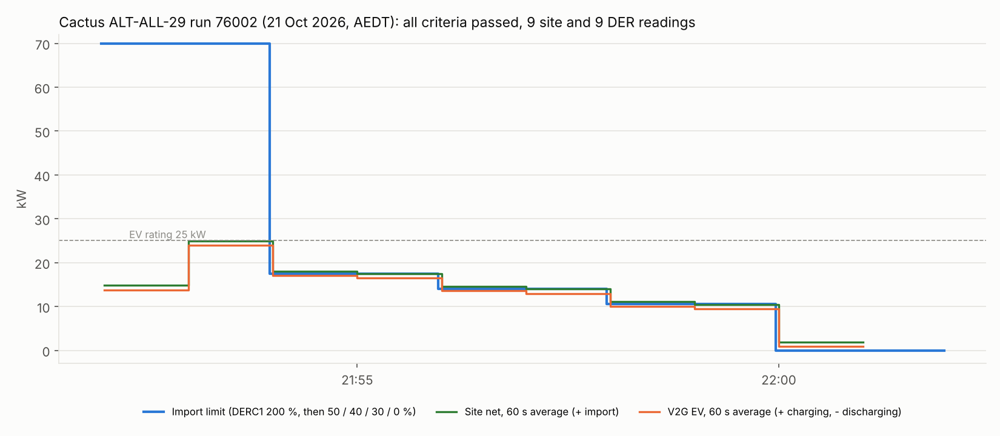

# Cactus ALT-ALL-29 (operating telemetry, EVSE alternate): run 76002 passed

**21 October 2026, 21:51:56–22:01:57 AEDT.** Cactus CSIP-AUS procedure ALT-ALL-29, class DER-A-ALT,
run 76002: **all three criteria passed, no warnings**:

| Criterion | Result |
|---|---|
| `all-steps-complete` | Passed (1 / 1 step) |
| `readings-site-active-power`, at least 8 | Passed: **9** site readings, all 60 s, aligned on minute boundaries, PEN-matched MRIDs |
| `readings-der-active-power`, at least 8 | Passed: **9** DER readings, same checks |

ALT-ALL-29 checks operating telemetry while five 2-minute controls step the import and export limits
down: 200 % (70 kW), 50 % (17.5 kW), 40 % (14 kW), 30 % (10.5 kW), then 0 W. Cactus used **35 kW**
(`setMaxW`, 10 kW solar + 25 kW V2G charger) for the percentages.

The readings are ODE's 60 s averages as posted to Cactus. ODE stamps each one with the end of its window;
the chart draws it over the window it covers.

## Set-up

| | |
|---|---|
| CSIP-AUS client | Open Dynamic Export App 0.1.5 on the Green, restarted at 21:51 before the run |
| CSMS and charger | CitrineOS 0.7.3, CitrineOS-HA 0.6.2, EVerest DC V2G simulator 0.1.13 (`SIM-EV-EVEREST-V2G-03`, 25 kW from its device model) |
| Bridge | [`bridge_automation.yaml`](../../plugfest-lab/ha/bridge_automation.yaml) at `6fb8c26`, **charging (import) mode**, with the house-load cover |
| Test load | Not used (`input_number.lab_test_load` 0 W); the procedure's 10 % test-load instruction is not scored |

## What happened

| Control (AEDT) | Import limit | EV (CitrineOS) | Site 60 s average |
|---|---|---|---|
| DERC1, 21:51:56 | 70 kW | 23.95 kW from 21:52:23 (rating less the house margin) | 24.9 kW |
| DERC2, 21:53:56 | 17.5 kW | 16.45 kW from 21:54:03 | 17.5 kW |
| DERC3, 21:55:56 | 14 kW | 12.95 kW from 21:56:03 | 14.0 kW |
| DERC4, 21:57:56 | 10.5 kW | 9.45 kW from 21:58:03 | 10.5 kW |
| DERC5, 21:59:56 | 0 W | **-950 W** (discharging, house-load cover) from 22:00:03 | 1.9 kW (window includes 11 s at 9.45 kW) |

The EV followed each step within 7 to 27 s, and the site stayed at the import limit in every full
minute. The last DER reading (22:00–22:01) averages **-914 W** because the EV was still charging for about
11 s of that window (minimum -9,450 W, maximum +950 W, in the DER sign); the run ended at 22:01:57 before a
full minute at -950 W was posted.

## Files

| File | |
|---|---|
| `data.json` | Cactus summary: criteria, the active-power readings ODE posted, and the timeline data streams (no device identifiers) |
| `make_chart.py` | Renders `alt-all29-chart.png` / `.svg` from `data.json`: `python3 make_chart.py` |
