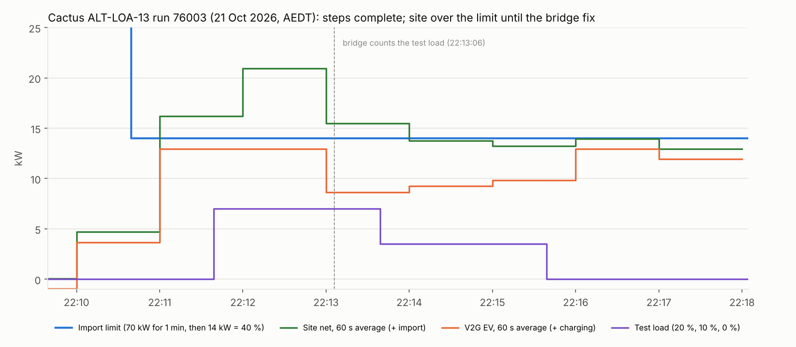

# Cactus ALT-LOA-13 (import limit with a site test load, EVSE alternate): run 76003

**21 October 2026, 22:09:39–22:18:04 AEDT.** Cactus CSIP-AUS procedure ALT-LOA-13, class DER-A-ALT,
run 76003: **Cactus criteria passed, no warnings**, but the **site went over the 14 kW import limit for about
1.5 minutes**. The bridge did not count the procedure's test load, and was fixed during the run.

| Criterion | Result |
|---|---|
| `all-steps-complete` | Passed (1 / 1 step) |
| `all-requests-xsd-valid` | Passed |

ALT-LOA-13 sets a 40 % import limit (14 kW of the 35 kW `setMaxW`) and asks the operator to add a site test load
outside the charger: 20 % (7 kW) at t = 120 s, 10 % (3.5 kW) at t = 240 s and 0 W at t = 360 s. The EV must give way
so the site stays within the limit. Cactus does not score the readings against the limit, so the result below
is from the readings ODE posted.

The readings are ODE's 60 s averages as posted to Cactus. ODE stamps each one with the end of its window;
the chart draws it over the window it covers.

## Set-up

| | |
|---|---|
| CSIP-AUS client | Open Dynamic Export App 0.1.5 on the Green, restarted before the run |
| CSMS and charger | CitrineOS 0.7.3, CitrineOS-HA 0.6.2, EVerest DC V2G simulator 0.1.13 (`SIM-EV-EVEREST-V2G-03`, 25 kW) |
| Bridge | [`bridge_automation.yaml`](../../plugfest-lab/ha/bridge_automation.yaml), **charging (import) mode**, house load 1 kW; at `6fb8c26` until 22:13:06, then with the test-load fix (`abf2e89`) |
| Test load | `input_number.lab_test_load`, stepped by a Green script from the run start (it is added to the synthetic site load that ODE reads) |

## What happened

| Window (AEDT) | Test load | EV 60 s average | Site 60 s average | Within 14 kW? |
|---|---|---|---|---|
| 22:10–22:11 | 0 | 3.7 kW (charging from 22:10:43 at 12.95 kW) | 4.7 kW | Yes |
| 22:11–22:12 | 7 kW from 22:11:39 | 12.95 kW | **16.2 kW** | **No** |
| 22:12–22:13 | 7 kW | 12.95 kW | **21.0 kW** | **No** |
| 22:13–22:14 | 3.5 kW from 22:13:39 | 8.6 kW (5.6 kW from 22:13:13, 9.27 kW from 22:13:48) | **15.5 kW** | **No** (fix mid-window) |
| 22:14–22:15 | 3.5 kW | 9.27 kW | 13.7 kW | Yes |
| 22:15–22:16 | 0 from 22:15:38 | 9.84 kW (12.95 kW from 22:15:48) | 13.2 kW | Yes |
| 22:16–22:17 | 0 | 12.95 kW | 14.0 kW (13,964 W) | Yes |
| 22:17–22:18 | 0 | 11.96 kW (run ending) | 12.9 kW | Yes |

**Cause.** In import mode the bridge charges at the site headroom: import limit + 95 % solar − 105 % house load.
It read only `input_number.lab_house_load`, so the 7 kW test load that ODE saw at the site meter left the EV
at 12.95 kW and the site at about 20.9 kW.

**Fix** (approved during the run, deployed 22:13:06, committed as `abf2e89`). The bridge now counts
`input_number.lab_test_load` as site load, the same as the house load. The EV dropped to the headroom 7 s later
(14 − 1.05 × 8 = 5.6 kW), then followed each step within 10 s: 9.27 kW at 3.5 kW and back to 12.95 kW at 0 W.
From 22:14 every full window was within the limit.

**Next.** Rerun ALT-LOA-13 with the fix in place from the start for a clean record.

## Files

| File | |
|---|---|
| `data.json` | Cactus summary and check results, the net active-power readings ODE posted, the timeline data streams, the test-load steps and the fix time (no device identifiers) |
| `make_chart.py` | Renders `alt-loa13-chart.png` / `.svg` from `data.json`: `python3 make_chart.py` |
