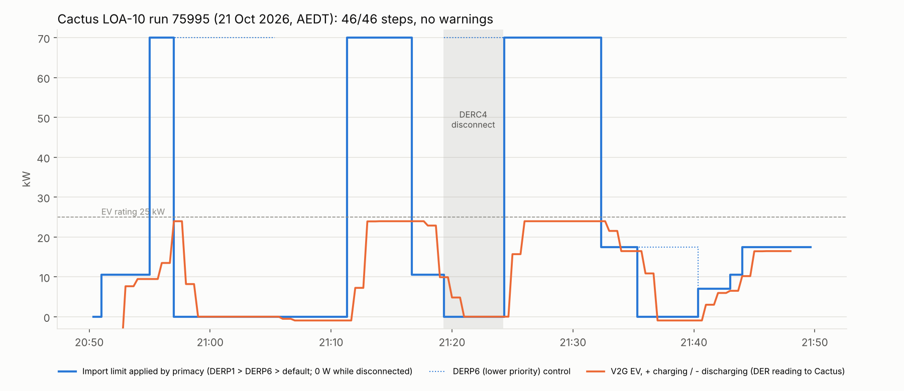

# Cactus LOA-10 (primacy validation for loads): run 75995 passed

**21 October 2026, 20:50–21:47 AEDT.** Cactus CSIP-AUS procedure LOA-10, class DER-L, run 75995:
**46 / 46 steps complete**. The criterion (`all-steps-complete`) and both precondition checks passed,
with **no warnings**.

LOA-10 is one of the procedures the Plugfest organisers say clients find hardest (with GEN-10, its
generation counterpart, which passed as run 75351). It runs two function-set assignments: FSA1 with five
DERPrograms at primacy 1 (higher priority, DERP1–5) and FSA2 with ten at primacy 2 (DERP6–15), and
checks that the client follows the higher-priority program whenever both set a control, sends
Superseded for a control overridden by a higher-priority one, and falls back to the right default.
Cactus used **35 kW** for `maxImportW`, the `setMaxW` ODE reports (10 kW solar + 25 kW V2G charger),
so 200 % is 70 kW, 50 % is 17.5 kW, 30 % is 10.5 kW and 20 % is 7 kW.

The EV line is ODE's DER reading as Cactus received it (60 s averages), so each step shows up to a
minute after the EV moved. The EV is capped by its 25 kW rating, so it charges at most 24 kW (25 kW
less the 1 kW house load margin) under the 70 kW controls.

## Set-up

| | |
|---|---|
| CSIP-AUS client | Open Dynamic Export App 0.1.5 on the Green, restarted at 20:49 before the run |
| CSMS and charger | CitrineOS 0.7.3, CitrineOS-HA 0.6.2, EVerest DC V2G simulator 0.1.13 (`SIM-EV-EVEREST-V2G-03`, rated 25 kW, read from its device model) |
| DER | Synthetic solar, `inverters/1` (about 0 at night); the V2G charger, `inverters/4` |
| Site | Synthetic meter: the real household meter + the simulated EV |
| Bridge | [`bridge_automation.yaml`](../../plugfest-lab/ha/bridge_automation.yaml) in **charging (import) mode** from 20:51. At 21:04 the house-load cover was deployed (`6fb8c26`): under an import limit below the house load, the V2G EV discharges to cover it |

## Steps, controls and ODE's responses

| Step (TS 5573) | Cactus (AEDT) | Control | What ODE did |
|---|---|---|---|
| (a, b) | 20:51:05 | DERP1 default 30 % (10.5 kW) | Applied; the EV charged about 9.5 kW |
| (c, d) | 20:55:05 | DERC1, DERP6, 200 % (70 kW), 600 s | Started 20:55:16. The EV rose to 24 kW |
| (e–g) | 20:57:06 | DERC2, DERP1, 0 W, 840 s | Started 20:57:11; **DERC1 Superseded 20:57:10**. The EV went to 0 W, then **-950 W from 21:05** (house-load cover) |
| (h) | 21:11:05 | DERC2 ends | Completed 21:11:05 |
| (i–k) | 21:11:14 | DERC3, DERP6, 200 %, 300 s | Started 21:11:24, Completed 21:16:15. The EV charged 24 kW |
| (l) | 21:16:15 | Back to the DERP1 default, 30 % | 10.5 kW for 2 minutes |
| (m–o) | 21:19:13 | DERC4, DERP1, load 0 W and **disconnect**, 300 s; DERC5, DERP6, 200 %, 1200 s | Both Started 21:19:17–24. The EV went to 0 W (disconnected) |
| (p, q) | 21:24:13 | DERC4 ends | Completed 21:24:13; reconnected to DERC5's 70 kW. The EV back at 24 kW |
| (s–u) | 21:32:23 | DERC6, DERP6, 50 % (17.5 kW), 300 s | Started 21:32:31; **DERC5 Superseded 21:32:31**. The EV about 16.5 kW |
| (v–x) | 21:35:21 | DERC7, DERP1, 0 W import; DERC8, DERP6, 50 % import / 30 % load | Both Started 21:35:25–31. DERC7 won: the EV **-950 W** (house-load cover). DERC7 Completed 21:40:22 |
| (y–aa) | 21:40:22 | DERC9, DERP1, load 50 %; DERC10, DERP6, import 20 % (7 kW) | Both Started 21:40:27–34. 7 kW import applied (only DERC10 sets it) |
| (bb–dd) | 21:42:29 | New defaults: DERP1 50 %, DERP6 20 %; active controls cancelled | DERP1 default 17.5 kW applied from 21:43:30 |
| (ee) | 21:42:34 | Wait 300 s | Finished 21:47:39 |

All 31 DERControlResponses were accepted (201), apart from one 403 at 20:50:00, before the run
registered the device: ODE answering a control left from the previous run (see
[ha-addons#86](https://github.com/purcell-lab/ha-addons/issues/86)). The responses Cactus did not match
to a step are the Received (1) responses ODE also sends.

## Observations

- **Primacy held in every overlap.** DERP1 won over DERP6 in DERC2 vs DERC1, DERC4 vs DERC5, and
  DERC7 vs DERC8; DERC9/10 combined (DERP1 sets only a load limit, so DERP6's import limit applied); the
  DERP1 default won over the DERP6 default at the end. ODE 0.1.4's default-control merge
  ([ha-addons#83](https://github.com/purcell-lab/ha-addons/issues/83)) is in use.
- **House-load cover (new, from 21:04).** Under DERC2 and DERC7 (0 W import, 0 W export, night) the EV
  discharged 950 W, the export-safe share of the 1 kW lab house load, so the site met the import limit.
  Before 21:04, under DERC2, the site imported the house load.
- **Reconnection after DERC4.** TS 5573 expects the load to wait 60 s and then ramp at 16 %/min. The
  bridge does not ramp charging (it soft-starts discharge only); the EV was back at 24 kW within about a
  minute. LOA-10 scores the responses, not the readings, so this did not affect the result.
- **Two profiles refused by the integration** at 20:55 and 21:01 with "Invalid lab period: W bounds"
  (CitrineOS-HA). The next profile was accepted each time and the EV followed the limits; to be
  investigated.
- Cactus's own "Site Power" series is not charted: it includes the real household meter, which this
  procedure does not control.

## Files

| File | |
|---|---|
| `data.json` | Cactus summary for the run: criteria, step times, responses and the timeline data streams (no device identifiers) |
| `make_chart.py` | Renders `loa10-chart.png` / `.svg` from `data.json`: `python3 make_chart.py` |
