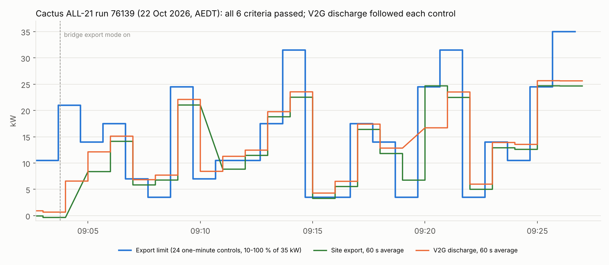

# Cactus ALL-21 (scheduling): run 76139 passed

**22 October 2026, 09:02:40–09:27:49 AEDT.** Cactus CSIP-AUS procedure ALL-21, classes A / DR-A, run 76139:
**all six criteria passed, no warnings**.

| Criterion | Result |
|---|---|
| `all-steps-complete` | Passed (1 / 1 step) |
| `response-contents`, status 1 (received) for every control | Passed, all 24 |
| `response-contents`, status 2 (started) for every control | Passed, all 24 |
| `response-contents`, status 3 (completed) for every control | Passed, all 24 |
| `all-polls-at-correct-time` (60 s) | Passed for `/dcap`, `/edev`, `/edev/1/fsa`, `/edev/1/der`, `/edev/1/fsa/1/derp`, `/edev/1/derp/1/dderc`, `/mup` |
| `all-requests-xsd-valid` | Passed |

ALL-21 sends 24 back-to-back one-minute controls (DERC1–24), each setting the import and export limits to
10–100 % of the 35 kW maximum (`setGradW` 27). Cactus scores the control responses and the polling, not power.

The readings are ODE's 60 s averages as posted to Cactus, drawn over the window each covers (ODE stamps them
with the window's end). The controls start at about 40 s past the minute, so most 60 s averages mix two
controls.

## Set-up

| | |
|---|---|
| CSIP-AUS client | Open Dynamic Export App 0.1.5 on the Green, restarted at 09:01 before the run |
| CSMS and charger | CitrineOS 0.7.3, CitrineOS-HA 0.6.2, EVerest DC V2G simulator 0.1.13 (`SIM-EV-EVEREST-V2G-03`, transaction `9a9dd27e`) |
| Bridge | [`bridge_automation.yaml`](../../plugfest-lab/ha/bridge_automation.yaml) at `9e5fa6f`, lab hold off, **export (discharge) mode from 09:03:46**, target 25 kW |
| Site | Morning solar about 2.6–3 kW; house load 1 kW; no test load |

## What happened

- **Charging, then discharging.** The run started in charging mode; export mode went on at 09:03:46 and the
  EV went from +3.9 kW to discharging within about 8 s.
- **The discharge followed every control.** In export mode the EV discharges at the export limit less the
  solar share (solar keeps priority on export), up to the 25 kW target. The V2G discharge tracks the export
  limit about 1–3 kW below it, rises with each increase and drops at each decrease.
- **Increases ramp, decreases don't.** ODE ramps each rise at `setGradW` (0.27 % of 35 kW per second, about
  95 W/s), so the larger steps up are reached late in the minute or not at all. The bridge applies a lower
  control at once (the active control is a ceiling on ODE's ramped value).
- **Up to 25.6 kW of discharge** under the last two controls (70 % and 100 %); the EV's 25 kW rating sets the
  ceiling.
- **Two readings missing** from the site series (09:05 and 09:11 windows); the DER series is complete.
- **The refusal check stayed clear** throughout (re-plugged session, discharge works).

## Files

| File | |
|---|---|
| `data.json` | Cactus summary and check results, the net readings ODE posted, the timeline data streams (no device identifiers) |
| `make_chart.py` | Renders `all21-chart.png` / `.svg` from `data.json`: `python3 make_chart.py` |
