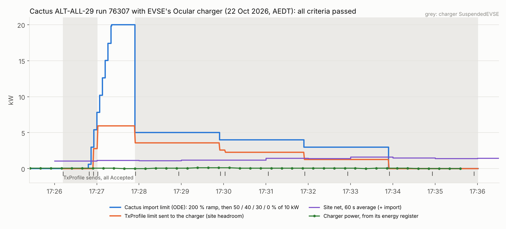

# Cactus ALT-ALL-29 with EVSE's Ocular charger: run 76307 passed

**22 October 2026, 17:25:54–17:36:00 AEDT.** Cactus CSIP-AUS procedure ALT-ALL-29, class DER-A-ALT,
run 76307: **all three criteria passed, no warnings**.

This is the first end-to-end run with a **vendor charger** at the Plugfest:
Cactus → Open Dynamic Export → Home Assistant bridge → CitrineOS → EVSE's Ocular IOCAH39-7S (OCPP 2.0.1).

| Criterion | Result |
|---|---|
| `all-steps-complete` | Passed (1 / 1 step) |
| `readings-site-active-power`, at least 8 | Passed: **11** site readings, all 60 s, aligned on minute boundaries, PEN-matched MRIDs |
| `readings-der-active-power`, at least 8 | Passed: **11** DER readings, same checks |

ALT-ALL-29 checks operating telemetry while five 2-minute controls step the import limit down from
200 % of `setMaxW` (10 kW here) to 50 %, 40 %, 30 % and then 0 W. Cactus scores the telemetry, not power.

## Set-up

| | |
|---|---|
| CSIP-AUS client | Open Dynamic Export App 0.1.5 on the Green, restarted after the run started |
| CSMS | CitrineOS 0.7.3 (command station `A39A261846129`, real-station commands on), CitrineOS-HA 0.6.2 |
| Charger | EVSE's Ocular IOCAH39-7S, firmware 26101201, OCPP 2.0.1, single-phase (`SupplyPhases` 1), `RateUnit` W,A; transaction `bed7211c` |
| Bridge | [`bridge_automation.yaml`](../../plugfest-lab/ha/bridge_automation.yaml): charge-only (`lab_bridge_charge_only` on), rating 7,360 W, lab hold off, house load 3,000 W, no test load |
| Limits sent | TxProfile 9001, stack 1, W, 600 s schedule ahead. The limit is the site headroom: import limit + 95 % of solar (about 1.5–2 kW) − 105 % of the house load, capped at the rating |

## Controls and what the charger did

| Control (AEDT) | Import limit | TxProfile limit sent | Charger |
|---|---|---|---|
| Before DERC1, 17:26:12 | 0 W (default) | 0 W | `SuspendedEVSE` |
| DERC1, 17:26:48 (ramped to 20 kW by 17:27:21) | 20 kW (200 %) | 2,780 W, then **5,940 W** from 17:27:01 | **`Charging`** from 17:27:01 |
| DERC2, 17:27:54 | 5 kW (50 %) | **3,580 W** | **`SuspendedEVSE`** from 17:27:54 (see below) |
| DERC3, 17:29:54 | 4 kW (40 %) | 2,580 W, then 2,270 W | `SuspendedEVSE` |
| DERC4, 17:31:54 | 3 kW (30 %) | 1,270 W | `SuspendedEVSE` |
| DERC5, 17:33:54 | 0 W | 0 W | `SuspendedEVSE` |

- **Every TxProfile was Accepted:** 14 sends, each within about 0.15 s. Each one already carried the run's
  next steps (the bridge's schedule ahead), so every step started on time without a new send.
- **The EV drew almost nothing:** about 60–120 W from the energy register (only
  `Energy.Active.Import.Register` is sampled), so the limits can't be seen in power. The charging-state
  changes show the charger acting on them.
- **Site import exceeded the 0 W limit in DERC5** (about 1.4–1.6 kW net import). That's expected: the
  3 kW house load exceeds solar, and a charging-only station can only stop charging, not cover house load.

## Finding: the charger suspended at 3,580 W

The charger stopped charging when the limit fell from 5,940 W to 3,580 W, well above its 6 A minimum on a
single phase (3,580 W ÷ 230 V = 15.6 A). The bridge's charge-only periods don't set `numberPhases`, so OCPP
assumes **3 phases**: 3,580 W ÷ 3 ÷ 230 V = **5.2 A per phase, below 6 A**, so the charger suspends.
5,940 W ÷ 3 ÷ 230 V = 8.6 A, which is why it charged at that limit.

- **Bridge fix:** send `numberPhases: 1` for a single-phase station (a `lab_bridge_phases` setting, or
  `EVSE.SupplyPhases` from the device model).
- **For EVSE:** confirm the charger applies `numberPhases` this way, and why `GetCompositeSchedule`
  falls back to 22,080 W on 3 phases while `SupplyPhases` is 1.

## Files

- `data.json`: the run's summary, criteria, Cactus timeline and the 60 s readings, without site identifiers.
- `lab_data.json`: ODE's import limit, every TxProfile sent, the charger's energy register and charging state.
- `make_chart.py`: renders the chart from both files.
