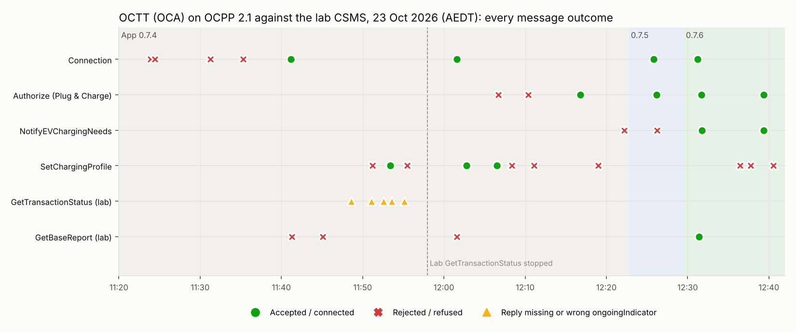
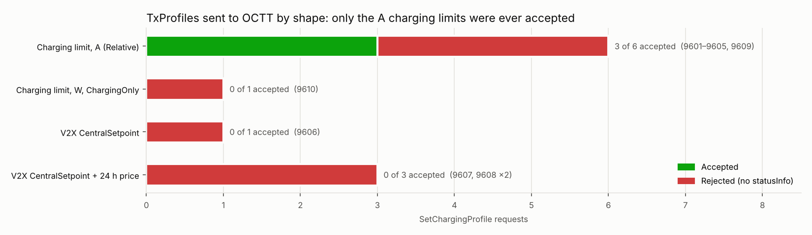

# OCA OCTT against the Purcell CitrineOS CSMS (23 October 2026)

**Status: closed.** 23 October 2026, 11:23–12:41 AEDT. The Open Charge Alliance's OCPP Compliance
Test Tool (OCTT), run by the OCA (Milan Jansen), connected to the Purcell CitrineOS CSMS over the
internet through the Cloudflare tunnel (`ocpp.purcell.id.au`), on **OCPP 2.1**, as station
`OCTT_OCA_21_2`.

## Executive summary

OCTT ran about 80 minutes of OCPP 2.1 sessions against the lab CSMS. Connection, authorisation
(RFID and ISO 15118 Plug & Charge) and transaction handling work. Two CitrineOS v2.0.1 gaps for
OCPP 2.1 bidirectional charging were found and fixed in the session (App 0.7.5 and 0.7.6, Green
build only). Smart charging is only partly proven: OCTT accepted 3 of 6 simple A charging limits and
none of the 5 W or bidirectional TxProfiles, always without a reason.

**Results**

- **Works:** internet transport (TLS through Cloudflare); BootNotification, Heartbeat,
  StatusNotification and TransactionEvent; RFID Authorize; Plug & Charge Authorize with OCSP
  certificate validation (after registering the eMAID); SetChargingProfile delivery and 2.1 schema
  validation; GetBaseReport.
- **Fixed on the day:**
  - **`allowedEnergyTransfer`** was never set in AuthorizeResponse, so every session defaulted to
    charging only. Fixed in **0.7.5**, verified 12:26:11.
  - **OCPP 2.1 AC V2X charging needs** (AC_BPT with only `v2xChargingParameters`) were Rejected.
    Fixed in **0.7.6**, verified 12:31:44. (0.7.4, from the Trialog slot the same day, fixed DC_BPT.)
  - The lab's **automatic GetTransactionStatus check** closed a transaction OCTT was still running.
    Stopped for OCTT at 11:58 by moving the command station. The lab's automatic **GetBaseReport**
    was also switched off at the user's request (applies at the next restart).
- **Not proven:** **bidirectional (V2X) TxProfiles.** Every CentralSetpoint profile, with or without
  the 24 h price schedule, was Rejected, including after the fixes. OCTT's EV asked for AC_BPT in
  ScheduledControl with a **0 W discharge limit**, so a discharge setpoint can't fit that session.
  A DC_BPT or DynamicControl session that allows discharge is needed to test it.
- **Not run:** the Cactus (CSIP-AUS) run with OCTT.

**Findings for the OCA**

1. `ongoingIndicator` missing from 4 of 5 GetTransactionStatusResponses, and `false` in 1 for a
   running transaction.
2. TxProfile responses look scripted: the same 6 A profile was accepted and rejected on different
   transactions, and no rejection carried `statusInfo`.
3. No MeterValues, so no profile's effect could be observed.
4. Station ID changed between attempts (`_1` → `_2`); no automatic reconnect after a server-side
   close; some transactions were replaced without an `Ended` event.

**Next steps:** agree a V2X test case with the OCA (Q-section, DC_BPT or discharge-capable AC_BPT,
DynamicControl) and rerun profile 9608. Then run Cactus with OCTT as the command station once the
lab's GetTransactionStatus check can be switched off by an option. Upstream the 0.7.5 and 0.7.6
patches to CitrineOS.

### Charts

Every message by type. Green circles are accepted, red crosses rejected or refused, amber triangles
GetTransactionStatus replies without a correct `ongoingIndicator`. The shaded bands show the
CitrineOS App version in use. The Authorize and NotifyEVChargingNeeds rows turn green after the
0.7.5 and 0.7.6 fixes; the SetChargingProfile row doesn't.

SetChargingProfile outcomes by profile shape: only the A charging limits were ever accepted (3 of 6).
Source data: [`data.json`](data.json); `python3 make_chart.py` renders both charts.

## What works

| Area | Result |
|---|---|
| Transport | OCTT reaches the CSMS over the internet through the Cloudflare tunnel (`wss://ocpp.purcell.id.au/<station-id>`, publicly trusted certificate, TLS 1.2+) |
| OCPP 2.1 session | Websocket upgrade with `ocpp2.1`; **BootNotification Accepted** (interval 60 s); StatusNotification for 2 EVSEs / 3 connectors accepted |
| Heartbeat | Answered throughout |
| Authorisation | `Authorize` with `C17E0001` (ISO14443) → **Accepted**; an unregistered token → Unknown, which is a correct result. Plug & Charge (eMAID + certificate, OCSP) → **Accepted** with `allowedEnergyTransfer` (0.7.5) |
| Charging needs | OCPP 2.1 NotifyEVChargingNeeds **AC_BPT** with `v2xChargingParameters` → **Accepted** (0.7.6), needs stored, no automatic profile |
| Transactions | Repeated `TransactionEvent` Started / Updated (CablePluggedIn, ChargingStateChanged, StopAuthorized) / Ended all accepted with `idTokenInfo` Accepted; charging states tracked in CitrineOS |
| CSMS commands | SetChargingProfile (TxProfile, Relative, A), GetChargingProfiles, RequestStartTransaction and GetBaseReport all delivered and answered (GetBaseReport Accepted with a full NotifyReport at 12:31); CitrineOS validated each payload against the 2.1 schema |
| Admission controls | Unknown station IDs and wrong Basic Auth passwords are refused as designed; open admission admits any ID |
| Lab isolation | With the bridge off and the command station moved, the lab sends nothing to OCTT except operator-triggered commands |

## Needs further investigation

| # | Item | Owner | Detail |
|---|---|---|---|
| 1 | **Lab GetTransactionStatus check closes running transactions** | Lab (CitrineOS App) | A single `ongoingIndicator: false` reply closed `6518777a` while OCTT kept running it. Stopped for this session by moving the command station; an option to switch the check off, and a less trusting close, are needed ([details](#issue-the-labs-gettransactionstatus-check-interferes-with-the-station-under-test)) |
| 2 | **`ongoingIndicator` missing or wrong in OCTT's replies** | OCA | `ongoingIndicator` is expected in GetTransactionStatusResponse when a `transactionId` is given. 4 of OCTT's 5 replies left it out, and 1 reported `false` for a transaction it was still running ([details](#issue-the-labs-gettransactionstatus-check-interferes-with-the-station-under-test)) |
| 3 | **TxProfile acceptance looks scripted** | OCA + lab | The 6 A Relative TxProfile was rejected twice when addressed to the current transaction (11:51, 11:55) and accepted when addressed to a stale one (11:53). After the GetTransactionStatus check stopped, it was **accepted for the current transaction** (12:02:47). Every acceptance was followed by GetChargingProfiles → NoProfiles, so OCTT doesn't report the installed profile. Rerun inside a K-section (Smart Charging) test case and compare with the expected profile (purpose, kind, unit, `transactionId`) |
| 4 | **Basic Auth credentials** | OCA + lab | Two refusals with the provisioned `OCTT_OCA_21_1` and its password (stored value verified). CitrineOS logs no detail. Confirm what OCTT sends (username = station ID?); lab: log the username and password length of refused attempts |
| 5 | **Station ID changed between attempts** | OCA | OCTT dialled `OCTT_OCA_21_1`, then connected as `OCTT_OCA_21_2`. Agree one ID per run so it can be provisioned with a password and open admission can be turned off |
| 6 | **Transactions superseded without `Ended`** | OCA | Several loop transactions (`0ddf4a7a`, `2a97ab44`, `28090acb`, `acbae304`) were replaced by the next one without an `Ended` event |
| 7 | **No meter values** | OCA | No MeterValues or power measurands in any transaction, so profiles can't be checked against delivered power |
| 8 | **Group tokens** | Lab | `CHILDTOKEN` (`KeyCode`) → Unknown. Group or parent tokens for OCTT's group-ID test cases aren't configured in CitrineOS |
| 9 | **Profile 1 (`ws://`) over the internet** | Lab (Cloudflare) | Port 80 is redirected to `https://` by the zone's Always Use HTTPS setting; profile 1 needs that off for `ocpp.purcell.id.au`, or OCTT on the venue LAN |
| 10 | **Reconnect after a CSMS restart** | OCA | OCTT doesn't reconnect by itself after the server closes the socket; each lab restart needs a manual reconnect |
| 11 | **Operational** | Lab | Each `plugfest_stations` change needs a full CitrineOS restart (about 60 s); duplicate Plugfest passwords make startup fail with a generic message; every refusal through Cloudflare is a 502 |
| 12 | **Pending tests** | OCA + lab | Stepped TxProfile accepted (12:06:32) but its effect isn't observable without meter values. A Cactus (CSIP-AUS) run needs OCTT as the command station, which turns the GetTransactionStatus check (item 1) back on |
| 15 | **`allowedEnergyTransfer` missing from AuthorizeResponse** (fixed in 0.7.5, verified 12:26:11) | Lab (CitrineOS) | CitrineOS v2.0.1 doesn't set the OCPP 2.1 `allowedEnergyTransfer` field, so every authorised session defaults to charging only. Bidirectional (`DC_BPT`, `AC_BPT`) sessions and CentralSetpoint discharge can't be negotiated. Fix: a build-time patch that adds the lab's allowed modes to an Accepted AuthorizeResponse (and NotifyAllowedEnergyTransfer for an ongoing session) |
| 16 | **AC V2X charging needs rejected** (fixed in 0.7.6, verified 12:31:44) | Lab (CitrineOS) | OCPP 2.1 AC needs with `v2xChargingParameters` but no `acChargingParameters` (AC_BPT, and AC with V2X parameters) are Rejected: upstream requires `acChargingParameters` for AC, and the 0.7.4 patch covers only the DC modes. Fix: also accept needs that carry `v2xChargingParameters`, store them, no automatic profile |
| 14 | **Bidirectional (V2X) TxProfile** | OCA | CentralSetpoint TxProfile Rejected without a reason. Which OCTT test case exercises OCPP 2.1 V2X (Q-section / `V2XChargingCtrlr`), and does OCTT need an authorised `DC_BPT` session (NotifyEVChargingNeeds) before it accepts one? |
| 13 | **Plug & Charge (ISO 15118) authorisation** | Lab | eMAID with certificate hash data → Unknown / `ContractCancelled`. The certificate check itself passed (OCSP); the eMAID token wasn't registered. Registered at about 12:15. **Confirmed at 12:16:49:** Authorize → Accepted / certificate Accepted |

## Set-up

| | |
|---|---|
| Test tool | OCTT (run by the OCA), BootNotification vendor `OCA`, model `2019`, firmware `Release_2026-09`, OCPP 2.1, 2 EVSEs |
| CSMS | CitrineOS v2.0.1 in the CitrineOS server App 0.7.4, then 0.7.5 (12:23) and 0.7.6 (12:29), Green build only, on a Home Assistant Green |
| Endpoint | `wss://ocpp.purcell.id.au/<station-id>` (Cloudflare Tunnel to the Plugfest listener on 8083). `ws://` on port 80 is redirected to `https://` by the zone's Always Use HTTPS setting |
| Admission | Provisioned stations with Basic Auth, then **open admission** from about 11:38 AEDT |
| Command station | `OCTT_OCA_21_2` from 11:42 AEDT. The lab bridge (ODE → TxProfile) was **off** except for about 2 minutes (11:45–11:47); it sent nothing |
| Token | `C17E0001` (ISO14443), registered as Accepted |

## Connection

| Time (AEDT) | Event | Cause / fix |
|---|---|---|
| 11:23:54, 11:24:26 | `UnknownStationFilter` failed for `OCTT_OCA_21_1` | Station ID not provisioned (the lab expected `purcell`). Provisioned at 11:29 |
| 11:29 | CitrineOS start failed | Plugfest passwords must be unique; the same password had been given to two IDs. Fixed by dropping the unused `purcell` entry |
| 11:31:14, 11:35:17 | `BasicAuthenticationFilter` failed for `OCTT_OCA_21_1` | The password OCTT sent didn't match the stored one (checked in the database). CitrineOS doesn't log the presented credentials |
| about 11:38 | **Open admission on** | No password check |
| 11:41:09 | **Connected as `OCTT_OCA_21_2`**, OCPP 2.1 | OCTT used a different ID from the one provisioned |
| 11:42 | Command station switched to `OCTT_OCA_21_2` (CitrineOS restart) | |
| 11:44:53 | **BootNotification Accepted**; StatusNotification for EVSE 1 and EVSE 2, all Available | |

## Commands from the CSMS

| Time (AEDT) | Command | OCTT response |
|---|---|---|
| 11:41:16, 11:45:07 | GetBaseReport `FullInventory` (lab automatic) | Rejected |
| 11:45:06 | RequestStartTransaction (EVSE 1, `C17E0001`) | Rejected |
| 11:51:13 | SetChargingProfile 9601: TxProfile, stack 1, **Relative**, 300 s, **6 A**, to the current transaction `28090acb` | **Rejected** |
| 11:53:24 | Same profile (9602), to `acbae304` (OCTT had already started `6518777a`) | **Accepted**, then GetChargingProfiles (CSO) → NoProfiles |
| 11:55:29 | Same profile (9603), to the current transaction `4383bf1d` | **Rejected** |

OCTT gave no `statusInfo` on any rejection. It accepted the profile only when it was addressed to a
transaction that was no longer current, so the responses look scripted by the running test case.

## Transactions

OCTT ran an authorise / start / charge / stop loop about once a minute, with `C17E0001`:

| Transaction | Started (AEDT) | How it ended in CitrineOS |
|---|---|---|
| `0ddf4a7a` | 11:48:24 | Inactive at 11:49:27 when the next transaction started on EVSE 1; no `Ended` event received |
| `2a97ab44` | 11:49:23 | Superseded by the next transaction |
| `28090acb` | 11:50:58 | Superseded by the next transaction (Idle) |
| `acbae304` | 11:52:29 | Superseded at 11:53:13 |
| `6518777a` | 11:53:12 | **Closed by CitrineOS at 11:53:37 after GetTransactionStatus** (see below). OCTT kept running it: `StopAuthorized` 11:54:51, `Ended` (`EVCommunicationLost` / `EVDisconnected`) 11:54:53 |
| `4383bf1d` | 11:54:54 | Active and Charging at 11:56 |

No MeterValues or power measurands were received for any transaction.

## Issue: the lab's GetTransactionStatus check interferes with the station under test

**What the lab does.** The CitrineOS server App's gateway (`launch.mjs`, `reconcile()`) checks the
*command station* every 30 s:
- it sends **GetTransactionStatus** for each transaction CitrineOS holds active for that station:
  once when the transaction is first seen, then every 5 minutes (`RECONCILE_EVERY_MS`), and for all of
  them when the station comes back online;
- if the station answers `ongoingIndicator: false`, upstream CitrineOS **marks the transaction
  inactive**.

It was added to clear stale transactions left after station reboots (see the lab issues on dispatch
lock-outs). It isn't part of any OCPP test case.

**What happened with OCTT.**

| Time (AEDT) | Transaction | OCTT reply | Effect |
|---|---|---|---|
| 11:48:37 | `0ddf4a7a` | `messagesInQueue: true`, **no `ongoingIndicator`** | none |
| 11:51:06 | `28090acb` | `messagesInQueue: true` | none |
| 11:52:36 | `acbae304` | `messagesInQueue: true` | none |
| **11:53:36** | **`6518777a`** | **`messagesInQueue: false`, `ongoingIndicator: false`** | **CitrineOS closed the transaction at 11:53:37, while OCTT kept it running until its `Ended` at 11:54:53** |
| 11:55:07 | `4383bf1d` | `messagesInQueue: true` | none |

**Why it matters.**
1. **The CSMS's view goes wrong.** After the 11:53:37 close, CitrineOS (and Home Assistant) showed no
   active transaction, while the station was still charging. Anything that needs an active
   transaction then stops: the lab's TxProfile bridge sends only for an open transaction.
2. **Unsolicited messages during conformance tests.** OCTT runs scripted test cases. An unexpected
   CSMS→station call in the middle of a case can fail or confuse it.
3. **The same mechanism hit Trialog.** In the Trialog slot (same day), the GetTransactionStatus
   calls at 10:54:02 and 11:02:32 came from this check, and the `ongoingIndicator: false` replies
   closed those transactions in CitrineOS. The Trialog report's issue "transaction stops without an
   `Ended` event" should be read with that in mind: the station's reply was the trigger, but the CSMS
   asked the question.

**For OCTT / the OCA.** `ongoingIndicator` is **expected** in a GetTransactionStatusResponse when
the request names a `transactionId` (OCPP 2.x use case E14, Check Transaction Status: the station
reports whether that transaction is still ongoing; the field is left out only when the request has no
`transactionId`). OCTT's replies didn't meet that:

| Transaction | OCTT reply | Expected |
|---|---|---|
| `0ddf4a7a` (11:48:37), `28090acb` (11:51:06), `acbae304` (11:52:36), `4383bf1d` (11:55:07) | `messagesInQueue: true`, **`ongoingIndicator` missing** | `ongoingIndicator: true` (all four were running) |
| `6518777a` (11:53:36) | `messagesInQueue: false`, **`ongoingIndicator: false`** | `ongoingIndicator: true`: OCTT kept the transaction running until its `Ended` at 11:54:53 |

So four replies left out a required field, and one gave the wrong value. The wrong value is what made
CitrineOS close the transaction early.

**For the lab (CitrineOS server App).**
1. Add an option to turn the GetTransactionStatus check off, and turn it off for conformance-tool and
   vendor slots. Today the only way to stop it is to move the command station to another identity,
   which needs a restart.
2. Don't close a transaction on a single `ongoingIndicator: false` while the station keeps sending
   TransactionEvents for it. Ask again, or wait for an `Ended` event, before treating it as closed.
3. Treat a reply without `ongoingIndicator` as "unknown", not as ongoing or ended (it's already
   handled this way).

## Other observations

- **Credentials aren't visible when Basic Auth fails.** CitrineOS logs only "Filter failed". A
  refused attempt's username and password length (never the password) would have saved several
  restarts. Each change to `plugfest_stations` also needs a full restart.
- **Through Cloudflare, every refusal is a 502.** OCTT can't tell a wrong password from an unknown ID.
- **OCTT's `CHILDTOKEN` (`KeyCode`)** got Unknown. CitrineOS has no group or parent tokens
  configured for OCTT's group-ID test cases.

## Progress log

Updated as testing continues. Times AEDT.

| Time | Change or result |
|---|---|
| about 11:58 | **Lab GetTransactionStatus stopped for OCTT.** Command station moved back to `SIM-EV-EVEREST-V2G-03` (CitrineOS restart), so the gateway's transaction check no longer targets `OCTT_OCA_21_2`. Operator UI commands (SetChargingProfile and so on) still reach `OCTT_OCA_21_2`. Last GetTransactionStatus to OCTT: 11:55:07 |
| 11:57:24 | `OCTT_OCA_21_2` disconnected by the restart. As of 12:02 it hadn't reconnected; OCTT doesn't reconnect by itself after a server-side close |
| 12:02 | Report sent to the OCA |
| 12:01:36 | **OCTT reconnected** as `OCTT_OCA_21_2`: BootNotification Accepted; EVSE 1 and EVSE 2 Available. Lab GetBaseReport → Rejected |
| 12:02:07–12:02:10 | Transaction **`b9d82116`**: Authorize `C17E0001` Accepted → Started → Occupied → CablePluggedIn → **Charging** |
| **12:02:47** | **SetChargingProfile 9604** (TxProfile, stack 1, Relative, 300 s, 6 A) to the **current** transaction `b9d82116` → **Accepted**. Follow-up GetChargingProfiles (CSO) → NoProfiles |
| 12:01–12:03 | **No GetTransactionStatus sent to OCTT** after the command-station change, confirming the fix for item 1. `b9d82116` stays active in CitrineOS |
| **12:06:32** | **TxProfile test, stepped:** SetChargingProfile 9605 (TxProfile, stack 1, Relative, A, 240 s: **16 A → 6 A (60 s) → 10 A (120 s) → 0 A (180 s)**) to `b9d82116` → **Accepted**. GetChargingProfiles (CSO) → **Accepted** this time, but no ReportChargingProfiles followed |
| 12:06:30–12:06:34 | OCTT ended `b9d82116` as the profile arrived: StopAuthorized → EVConnected → Available → `Ended` (`EVCommunicationLost` / `EVDisconnected`). The step-by-step effect can't be observed (no meter values, transaction ended) |
| 12:06:35–12:06:43 | OCTT starts a new case: transaction `4ab751aa` (`CablePluggedIn`), then `Authorize` with an **eMAID** (`AAAAAAAAAAAAAA`) and ISO 15118 certificate hash data → CitrineOS answers **Unknown**, `certificateStatus: ContractCancelled`. Plug & Charge contract certificates aren't set up in the lab CSMS (new item 13) |
| **12:08:22** | **Bidirectional TxProfile:** SetChargingProfile 9606 (TxProfile, stack 1, Relative, W, 300 s, OCPP 2.1 **CentralSetpoint**, `limit` 15 kW, `dischargeLimit` −15 kW, setpoints **+15 / −15 / +6 / −5 / 0 kW**, 60 s each) to `4ab751aa` → **Rejected**, no `statusInfo`. GetChargingProfiles → NoProfiles. `4ab751aa` was EVConnected and its Plug & Charge authorisation had been refused, so the rejection may reflect that, or that OCTT's station profile doesn't support V2X (new item 14) |
| 12:10:17–12:10:23 | OCTT restarts its session: `4ab751aa` Ended (`EVDisconnected`); new transaction **`958d8179`** (`CablePluggedIn`, EVConnected); `Authorize` eMAID with certificate hash → Unknown / `ContractCancelled` (same Plug & Charge case) |
| **12:11:07** | **Bidirectional TxProfile with price schedule:** SetChargingProfile 9607 (as 9606, plus `absolutePriceSchedule`: AUD, ISO 15118-20 Price Algorithm 1 (Power), one rule stack of 600 s at 0.318 AUD/kWh from 0 W, time anchor 12:10:00) to `958d8179` → **Rejected**, no `statusInfo`. GetChargingProfiles → NoProfiles. The transaction wasn't authorised (Plug & Charge refused) and no `DC_BPT` charging needs had been sent |
| about 12:15 | **Plug & Charge enabled for OCTT.** CitrineOS already validated OCTT's contract certificate (OCSP to the OCTT test PKI) as Accepted; the `ContractCancelled` result came from OCPP C07.FR.13 because the eMAID wasn't a known token. Registered the eMAID `AAAAAAAAAAAAAA` (type `eMAID`, Accepted) in CitrineOS |
| about 12:15 | Bridge price schedule captured: the full 24 h `absolutePriceSchedule` from the bridge's last TxProfile (11:02:28 AEDT, OpenADR NSW1 import forecast, 48 × 30 min stacks, 0.184–0.445 AUD/kWh): [`bridge-price-schedule.json`](bridge-price-schedule.json). The bidirectional CentralSetpoint TxProfile with that schedule: [`bidirectional-txprofile-priced.json`](bidirectional-txprofile-priced.json) |
| 12:16:43–12:16:44 | New transaction **`0ed5b6f0`** (`CablePluggedIn`, EVConnected) |
| **12:16:49** | **Plug & Charge Authorize Accepted:** eMAID `AAAAAAAAAAAAAA` with ISO 15118 certificate hash data → `idTokenInfo` **Accepted**, `certificateStatus` **Accepted** (OCSP check against the OCTT test PKI, about 4.4 s) |
| about 12:20 | **OCTT reports `allowedEnergyTransfer` missing** from the AuthorizeResponse. Confirmed in CitrineOS v2.0.1: the OCPP 2.1 Authorize handler never sets it, and per OCPP 2.1 an omitted `allowedEnergyTransfer` **defaults to charging only**. So no session authorised by this CSMS may use bidirectional transfer, which explains the rejected CentralSetpoint TxProfiles (new item 15) |
| **12:18:58** | **SetChargingProfile 9608** (bidirectional CentralSetpoint +15 / −15 / +6 / −5 / 0 kW with the bridge's full 24 h price schedule) to the Plug & Charge transaction `0ed5b6f0` (authorised, EVConnected) → **Rejected**, no `statusInfo`; GetChargingProfiles → NoProfiles. Consistent with item 15: without `allowedEnergyTransfer` the session is charging-only, so negative setpoints aren't allowed |
| 12:22:09–12:22:13 | Transaction `c9016ce0`: Authorize `C17E0001` Accepted (0.7.4, no `allowedEnergyTransfer`); **NotifyEVChargingNeeds** `requestedEnergyTransfer` AC, `availableEnergyTransfer` AC_single_phase / AC_three_phase / AC_BPT, `v2xChargingParameters` only (no `acChargingParameters`) → **Rejected** (new item 16) |
| about 12:23 | **CitrineOS 0.7.5 deployed (Green only)**: build-time patch adds `allowedEnergyTransfer` (DC, DC_BPT, AC single/two/three phase, AC_BPT) to every Accepted OCPP 2.1 AuthorizeResponse. Restart disconnected OCTT at 12:22:44 |
| 12:25:51–12:25:55 | OCTT reconnected; transaction **`8134ad15`** (`CablePluggedIn`) |
| **12:26:11** | Plug & Charge Authorize → `idTokenInfo` Accepted, `certificateStatus` Accepted, **`allowedEnergyTransfer` [DC, DC_BPT, AC_single_phase, AC_two_phase, AC_three_phase, AC_BPT]**: item 15 fixed |
| 12:26:15 | **NotifyEVChargingNeeds** `requestedEnergyTransfer` **AC_BPT**, `availableEnergyTransfer` AC_single_phase / AC_two_phase / AC_three_phase / AC_BPT / AC_BPT_DER / AC_DER, `v2xChargingParameters` maxCharge 1,234 W, maxDischarge 0 W, no `acChargingParameters` → **Rejected** (item 16). OCTT's session is on the AC path, not DC |
| about 12:29 | **CitrineOS 0.7.6 deployed (Green only)**: the charging needs patch also accepts any OCPP 2.1 needs with `v2xChargingParameters` (OCTT's AC_BPT), stores them and sends no automatic profile (item 16) |
| 12:31:12 | OCTT back online as `OCTT_OCA_21_2` after the restart. No new transaction or charging needs yet; `8134ad15` still listed as active from before the restart |
| 12:31:23 | New transaction **`89b44201`** (`CablePluggedIn`). Lab GetBaseReport → **Accepted**; NotifyReport streams the device model (SmartChargingCtrlr PeriodsPerSchedule 10, AlignedDataCtrlr Interval 10 s, TxStartedMeasurands Energy.Active.Import.Register) |
| 12:31:41 | Plug & Charge Authorize (eMAID, certificate hash data) → **Accepted**, certificate Accepted, `allowedEnergyTransfer` DC / DC_BPT / AC_single_phase / AC_two_phase / AC_three_phase / AC_BPT; TransactionEvent `Authorized` Accepted |
| 12:31:43–12:31:44 | **NotifyEVChargingNeeds** AC_BPT, `v2xChargingParameters` maxCharge 1,234 W, maxDischarge 0 W → **Accepted** (0.7.6). **Item 16 verified.** Transaction still `EVConnected`; with maxDischarge 0 W this AC session can't exercise discharge, so the bidirectional TxProfile needs a DC_BPT (or AC_BPT with discharge) session from OCTT |
| about 12:40 | At the user's request, the lab's automatic GetBaseReport (option `device_model_reports`) is set **off**. It takes effect at the next CitrineOS restart. The GetBaseReport at 12:31 came from this lab feature, not from an operator |
| **12:36:28** | **TxProfile, AC path:** SetChargingProfile 9609 (TxProfile, stack 1, Relative, 300 s, 6 A, same shape as the accepted 9604) to `89b44201` (AC_BPT, `EVConnected`) → **Rejected**, no `statusInfo`. Follow-up GetChargingProfiles (CSO) → NoProfiles |
| **12:37:47** | SetChargingProfile **9610** (TxProfile, stack 1, Relative, 300 s, **W**, 1,000 W, `operationMode` ChargingOnly, inside the EV's 1,234 W maximum) to `89b44201` → **Rejected**, no `statusInfo`. GetChargingProfiles → NoProfiles. Neither the unit nor the operation mode changes OCTT's answer, which points to acceptance being set by OCTT's test case (item 3) |
| 12:39:13–12:39:22 | OCTT restarted its bidirectional test case: `89b44201` Ended (EVCommunicationLost); new transaction **`53a27180`**; Plug & Charge Authorize → Accepted with `allowedEnergyTransfer`; NotifyEVChargingNeeds AC_BPT, **ScheduledControl**, maxCharge 1,234 W, maxDischarge 0 W → Accepted |
| **12:40:32** | **Bidirectional TxProfile 9608 with power and price** (CentralSetpoint +15 / −15 / +6 / −5 / 0 kW, 60 s steps, ±15 kW limits, 24 h `absolutePriceSchedule` from the bridge) to `53a27180` → **Rejected**, no `statusInfo`. GetChargingProfiles → NoProfiles. OCTT's EV asked for ScheduledControl with 0 W discharge, and CentralSetpoint is a DynamicControl mode with discharge, so the profile doesn't fit the session OCTT set up (item 14) |

## Open items

- **Lab clean-up after the event:** turn open admission off, or stop the Cloudflare tunnel; turn the
  ODE bridge automation back on when the lab is needed again; restart CitrineOS so
  `device_model_reports: false` applies.
- **Lab (CitrineOS App):** an option to switch off the GetTransactionStatus check, and don't close a
  transaction on a single `ongoingIndicator: false`; log the username and password length of refused
  Basic Auth attempts; upstream the 0.7.5 (`allowedEnergyTransfer`) and 0.7.6 (V2X charging needs)
  patches.
- **With the OCA:** a V2X test case for the bidirectional TxProfile, and a Cactus run with OCTT.

## Files

| File | What it is |
|---|---|
| `data.json` | Message outcomes behind the charts |
| `make_chart.py` | Renders `octt-timeline` and `octt-profiles` (`.png`, `.svg`) |
| `bridge-price-schedule.json` | The bridge's 24 h `absolutePriceSchedule` (OpenADR NSW1 import forecast) |
| `bidirectional-txprofile-priced.json` | The bidirectional CentralSetpoint TxProfile (9608) with that schedule |
