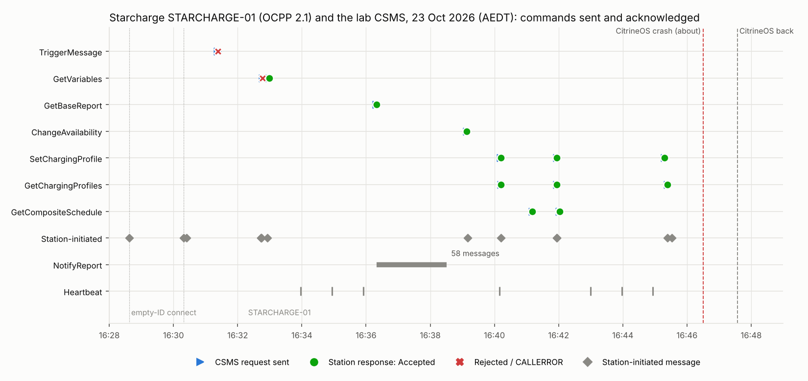
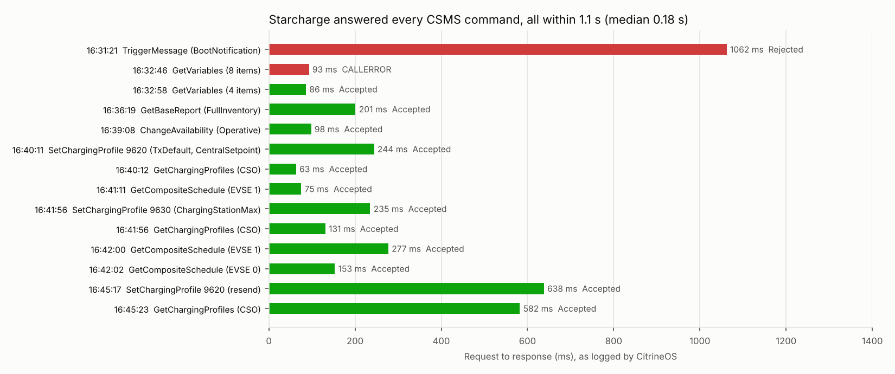

# Starcharge against the Purcell CitrineOS CSMS (23 October 2026, slot 10)

**Status: closed.** 23 October 2026, about 16:19–16:50 AEDT. Starcharge V2G charging station
(Plugfest slot 10) against the Purcell CitrineOS CSMS. Times are AEDT.

## Executive summary

StarCharge's bidirectional DC charger (model AD20074EU1923, firmware v3.20.5-standard, 7.4 kW
single phase) connected to the Purcell CitrineOS CSMS on **OCPP 2.1** over the venue LAN as
`STARCHARGE-01`. **No EV could be plugged in**, so the session tested everything that doesn't
need a transaction. The planned TxProfile and Cactus runs weren't possible.

**Results**

- **The station answered all 14 CSMS commands**, with a median response time of 0.18 s and all
  within 1.1 s. Twelve were Accepted. The two that weren't were correct by the specification:
  a triggered BootNotification after an Accepted boot (Rejected), and a GetVariables request
  larger than the station's limit of 4 items (CALLERROR).
- **V2X smart charging:** the station accepted an OCPP 2.1 **CentralSetpoint TxDefaultProfile**
  (+7.4 / −7.4 / +3.0 / −2.5 / 0 kW) and reported it back under `chargingLimitSource` **CSO**.
  It's the first vendor station today to accept a bidirectional profile. It also accepted a
  **ChargingStationMaxProfile**, and its station-level composite schedule matched that profile to
  the second.
- **Device model:** GetBaseReport FullInventory returned 58 NotifyReport messages. They show
  V2X enabled (DC, DC_BPT; ChargingOnly, CentralSetpoint, LocalLoadBalancing), W rate unit,
  AS/NZS 4777.2 grid settings and AU grid code AUA.
- **Availability:** the station came up **Unavailable**. CSMS ChangeAvailability Operative made
  it Available.

**Findings for StarCharge**

1. **Credentials in the device model report:** a password hash, a plain-text PIN and the local
   authorisation list are readable through GetBaseReport. The authorisation list is also sent in
   NotifyEvent. These should be WriteOnly or not reported.
2. The EVSE composite schedule ignores the station maximum profile, and gives an empty period
   when no profile applies.
3. Composite schedule periods carry `numberPhases: 0` and `phaseToUse: 0`.
4. `setpoint: 0` is dropped when the profile is reported back.
5. `ClockCtrlr.DateTime` reports local time labelled as UTC. Message timestamps are correct.

**Findings for the lab**

1. Open admission accepted a WebSocket with **no station ID**, which CitrineOS can't store or
   address. It should be refused.
2. **CitrineOS crashed** at about 16:46. The upstream server exited with a native stack trace,
   and the App's watchdog restarted it by 16:47:34. Starcharge hadn't reconnected by 16:50, so the
   two profiles couldn't be cleared. 9630 expired at 16:57; 9620 is still installed on the station.
3. Cloudflared stopped after the 16:10 network loss and wasn't restarted (watchdog off).

### Charts

Each CSMS command is a blue triangle when sent and a coloured marker when the station answered:
green for Accepted, red for Rejected or CALLERROR. Station-initiated messages, the NotifyReport
stream and Heartbeats are shown below. The dashed lines mark the CitrineOS crash and restart.

Request-to-response time for each command, as logged by CitrineOS. The two slowest Accepted
replies, at 16:45, came just before the CitrineOS crash. Source data: [`data.json`](data.json);
`python3 make_chart.py` renders both charts.

## What works

| Area | Result |
|---|---|
| Connection | OCPP 2.1 over the venue LAN (port 8083, Security Profile 1), open admission, Heartbeat |
| Device model | GetVariables (4 per request) and GetBaseReport FullInventory Accepted, full NotifyReport |
| Availability | ChangeAvailability Operative Accepted; connector Unavailable → Available |
| Station power limit | ChargingStationMaxProfile (Absolute, 3 steps) Accepted; the station-level composite schedule follows it exactly |
| V2X smart charging | OCPP 2.1 **CentralSetpoint TxDefaultProfile** with charge and discharge setpoints **Accepted**, and reported back under `chargingLimitSource` CSO |

## Needs further investigation

| # | Item | Owner | Detail |
|---|---|---|---|
| 1 | **Empty station ID admitted** | Lab (CitrineOS App) | Plugfest open admission accepted a WebSocket with no station ID in the path. CitrineOS then can't store its messages or address it. The listener should refuse an empty identity (HTTP 400/404) so the station sees a clear failure |
| 3 | **Secrets in the device model report** | Starcharge | The base report returns `ConfigurationCtrlr.Password` (a password hash), `ConfigurationCtrlr.PinPassword` (a plain PIN), the local authorisation list and setup card token, and the SIM's IMSI and ICCID. Credentials should be WriteOnly and not reported. Values are not recorded here |
| 4 | **Station clock** | Starcharge | `ClockCtrlr.DateTime` read 15:36:19**Z** at 05:36 UTC: local time labelled as UTC (time zone `Etc/GMT-10` / `UTC+10`; the venue is on AEDT, UTC+11). `TimeSource` is Heartbeat. The station's own message timestamps are correct UTC (StatusNotification 05:39:10Z at 16:39:10 AEDT), so only the reported `DateTime` value is mislabelled |
| 6 | **Zero setpoint dropped in ReportChargingProfiles** | Starcharge | Period 5 of 9620 was sent with `setpoint: 0`; the report omits `setpoint`. Check whether the station stores 0 or "no setpoint" for that period |
| 7 | **Empty composite schedule period** | Starcharge | GetCompositeSchedule with no transaction returns a period with no `limit`. OCPP 2.1 makes `limit` optional, but the composite schedule is meant to give the effective limit, here the 7.4 kW rating |
| 8 | **EVSE composite schedule ignores the station maximum** | Starcharge | With ChargingStationMaxProfile 9630 active, GetCompositeSchedule for EVSE 1 returns no limit. The EVSE's composite schedule should include the station-wide limit (3.7 kW at the time) |
| 9 | **`numberPhases: 0` and `phaseToUse: 0`** | Starcharge | In the EVSE 0 composite schedule. `numberPhases` should be 1–3 (or omitted), and `phaseToUse` only appears with `numberPhases` 1 |
| 10 | **Local authorisation list in NotifyEvent** | Starcharge | After boot the station sends `LocalAuthListCtrlr.ListContent` (token IDs) as CustomMonitor NotifyEvents. Part of item 3 |
| 11 | **CitrineOS crash at about 16:46** | Lab (CitrineOS) | Upstream server exited with a native stack trace after slow ReportChargingProfiles handling (7–9 s); second CitrineOS restart today. Logs to be kept for analysis |
| 5 | **No plug-in available** | Starcharge | No EV can be connected, so no transaction, TxProfile or Cactus session is possible today. The station was **Unavailable** until the CSMS sent ChangeAvailability Operative (16:39:08); then connector 1 became Available |
| 2 | **Station ID missing from the connection URL** | Starcharge | The CSMS URL must end with the station ID: `ws://<host>:8083/<station-id>` (OCPP 2.x Security Profile 1) |

## Set-up

| | |
|---|---|
| Station | StarCharge **AD20074EU1923**, firmware **v3.20.5-standard**, serial SN2604180222 (BootNotification at 16:32:43 and GetVariables). Station ID **`STARCHARGE-01`**, **OCPP 2.1**, EVSE 1 / connector 1 |
| CSMS | CitrineOS v2.0.1 in the CitrineOS server App **0.7.7** (Green build only: OCPP 2.1 DC_BPT and V2X charging needs accepted, `allowedEnergyTransfer` in AuthorizeResponse, metering-only SetVariables) |
| Endpoint | Venue LAN, port 8083, Security Profile 1 (`ws://<green>:8083/STARCHARGE-01`) |
| Admission | Plugfest **open admission on** (any station ID, no password) |
| Command station | Carried over from the ChargeSim session: `charger1`. To drive Starcharge from the lab bridge it must become the command station (CitrineOS restart) |
| Bridge | Carried over: automation on, prefix `citrineos_lab_charger1`, **charging-only**. For a V2G station: prefix `citrineos_lab_<station-id>`, charging-only **off** (CentralSetpoint periods), lab hold as needed, export mode for discharge tests |
| Tokens | `C17E0001`, `00054321` (ISO14443), eMAID `AAAAAAAAAAAAAA` (Plug & Charge), all Accepted |
| Lab automatics | Automatic GetBaseReport off |

## Device model (GetBaseReport, 16:36)

| Area | Reported |
|---|---|
| Station | StarCharge AD20074EU1923, firmware v3.20.5-standard, 1 EVSE / 1 connector, **single phase**, 35 A max (charge and discharge), grid power 7.4 kW, grid code AUA, grid type TN, country AU |
| V2X | `V2XChargingCtrlr` enabled; energy transfer **DC, DC_BPT**; operation modes **ChargingOnly, CentralSetpoint, LocalLoadBalancing** |
| Smart charging | Rate unit **W**, ProfileStackLevel 99, PeriodsPerSchedule 1024, SetpointPriority CSMS, no profiles installed |
| Metering | SampledDataCtrlr TxUpdatedInterval 10 s; AlignedDataCtrlr off (60 s interval) |
| Grid (AS/NZS 4777.2) | Active power rise/fall and reconnect rate 16.67 %/min, reconnect wait 60 s, voltage limits 0.89–1.10 pu, frequency 47.5–50.15 Hz, anti-islanding on |
| Local controls | LocalLoadBalancing and PeakShifting enabled; PV and DLC off; external GCP meter (EM112) configured but off |
| Availability | Connector 1 `Available=false`, EVSE and station AvailabilityState **Unavailable** |
| Device data limits | ItemsPerMessage 4 for GetVariables, SetVariables and GetReport (BytesPerMessage 5000) |
| Security | SecurityProfile 0, Basic Auth password unset, 3 certificates installed |
| Clock | Time zone `Etc/GMT-10`, NTP manual, time source Heartbeat |

## Connection

| Time (AEDT) | Event | Cause / fix |
|---|---|---|
| | | |

## Commands from the CSMS

| Time (AEDT) | Command | Starcharge response |
|---|---|---|
| | | |

## Transactions

| Transaction | Started (AEDT) | How it ended |
|---|---|---|
| | | |

## Progress log

Updated as testing continues. Times AEDT.

| Time | Change or result |
|---|---|
| about 16:19 | Test record opened. The Green was still unreachable from outside: `wss://ocpp.purcell.id.au` → Cloudflare 530 (tunnel down) and HA-OCPP 502, since about 16:10 (see the [ChargeSim report](../2026-10-23-chargesim-cactus/README.md)). Starcharge on the venue LAN works only if the Green itself is up |
| 16:26 | HA-OCPP reachable again; CitrineOS running (the lab's simulators online). **Starcharge not connected** (no new station since 16:10); ChargeSim's 11 stations offline. **Cloudflared App in `error` state**: it lost its Cloudflare edge connections at 16:10:2x (QUIC "no recent network activity", a venue network loss) and stopped, so `wss://ocpp.purcell.id.au` returns 530. The venue LAN endpoint `ws://purcell.local:8083` doesn't depend on it |
| 16:22:17 | CitrineOS had restarted after the 16:10 network loss (startup in its log); the lab's simulators reconnected |
| 16:28 | Starcharge trying the venue LAN listener on port 8083 |
| **16:28:37** | **A station connected on OCPP 2.1 with an empty station ID** (`ocppConnectionName` ""), CitrineOS station 110, admitted by open admission. It sends Heartbeats and CitrineOS answers them, but every message fails to persist (`ocpp-message-persist failed`, dead-lettered), so no BootNotification or other message is recorded and no command can target it. The connection URL had no station ID in its path (`ws://<host>:8083/` instead of `ws://<host>:8083/<station-id>`) |
| 16:30:18 | The empty-ID connection closed |
| **16:30:19** | **Starcharge connected as `STARCHARGE-01`**, OCPP 2.1, venue LAN port 8083 (CitrineOS station 112) |
| 16:30:24 | StatusNotification EVSE 1 / connector 1 **Unavailable** → accepted |
| 16:31:21 | TriggerMessage `BootNotification` → **Rejected**. Correct per OCPP 2.x (F06.FR.17): a station whose last BootNotification was Accepted rejects a triggered one, so Starcharge's boot was accepted earlier, on the 16:28:37 empty-ID connection, whose messages CitrineOS couldn't store |
| 16:32:43 | Starcharge rebooted: **BootNotification `PowerUp` → Accepted** (StarCharge AD20074EU1923, v3.20.5-standard, with modem details), SecurityEventNotification `ResetOrReboot`, NotifyEvent (local authorisation list content as a CustomMonitor event), StatusNotification |
| 16:32:46 | GetVariables with 8 entries → CALLERROR `OccurrenceConstraintViolation`. Correct: the station's `ItemsPerMessage` for GetVariables is 4 (from the base report), so the CSMS request was too large |
| **16:32:58** | GetVariables, ChargingStation VendorName / Model / SerialNumber / FirmwareVersion only → **Accepted ×4**: **StarCharge**, model **AD20074EU1923**, serial SN2604180222, firmware **v3.20.5-standard** |
| **16:36:19** | **GetBaseReport `FullInventory` (requested by the operator) → Accepted**; NotifyReport streamed 4 variables per message (24+ messages by 16:37:13). Highlights below |
| **16:39:08** | **ChangeAvailability `Operative`** (whole station) → **Accepted** |
| 16:39:10 | StatusNotification EVSE 1 / connector 1 **Available** (message timestamp 05:39:10Z, correct UTC) |
| **16:40:11** | **SetChargingProfile 9620, TxDefaultProfile** (EVSE 1, stack 0, Relative, W, 300 s, **CentralSetpoint**: setpoints +7.4 / −7.4 / +3.0 / −2.5 / 0 kW in 60 s steps, limit 7.4 kW, dischargeLimit −7.4 kW) → **Accepted** |
| 16:40:12 | CitrineOS's automatic GetChargingProfiles (`chargingLimitSource` CSO) → **Accepted**; ReportChargingProfiles returns 9620 with all 5 periods, so Starcharge files CSMS profiles under **CSO** (correct). The last period comes back **without its `setpoint: 0`** |
| 16:41:11 | **GetCompositeSchedule** (EVSE 1, 300 s, W) → **Accepted**: one period `{startPeriod: 0}` with **no limit, setpoint or operation mode**, scheduleStart 05:41:11Z. Without a transaction the Relative TxDefaultProfile has no start, so nothing constrains the EVSE; a composite schedule would normally still state the limit in force (the station maximum, 7.4 kW) |
| **16:41:56** | **SetChargingProfile 9630, ChargingStationMaxProfile** (EVSE 0, stack 0, Absolute from 05:42:00Z, W, 900 s: **3.7 → 2.0 → 5.0 kW** at 0 / 300 / 600 s) → **Accepted**. CitrineOS's GetChargingProfiles (CSO) → Accepted; ReportChargingProfiles returns 9630 (EVSE 0) and 9620 (EVSE 1), both `chargingLimitSource` CSO |
| 16:42:00 | GetCompositeSchedule **EVSE 1**, 900 s → Accepted, but again a single empty period: the station maximum profile is **not** reflected in the EVSE's composite schedule |
| 16:42:02 | GetCompositeSchedule **EVSE 0** (station), 900 s → Accepted: **3.7 kW, 2.0 kW from 298 s, 5.0 kW from 598 s**, then an empty period from 898 s, which matches 9630 started at 05:42:00Z. Each period carries `operationMode` ChargingOnly and **`numberPhases: 0`, `phaseToUse: 0`** |
| 16:45:17 | **TxDefaultProfile 9620 resent** (same profile: CentralSetpoint +7.4 / −7.4 / +3.0 / −2.5 / 0 kW, 60 s steps) → **Accepted** at 16:45:18; replaces the installed 9620 |

## Plan

1. **TxProfile test** once Starcharge connects: profiles sent through the operator route to its
   station ID (no command-station change, no restart). First the station's details from
   BootNotification, then a remote start or the station's own session, then TxProfiles.
2. **Cactus run** after that: Starcharge becomes the command station (CitrineOS restart, so it
   reconnects once), the bridge goes to `citrineos_lab_<station-id>` with charging-only **off**
   (V2G CentralSetpoint periods), lab hold **off**, and the house load is set for the run.
   Metering SetVariables (0.7.7) if Starcharge doesn't send power by default.

| 16:45:23–16:45:40 | CitrineOS's GetChargingProfiles → Accepted; two ReportChargingProfiles, answered 7 s and 9 s later (CitrineOS slowing down) |
| about 16:46 | **CitrineOS crashed**: upstream server exited (native stack trace), gateway closed; the App watchdog restarted it, ready 16:47:34. Starcharge disconnected and hadn't reconnected by 16:50 |
| 16:48:33–16:48:35 | ClearChargingProfile 9620 and 9630 → not sent ("No connection found for STARCHARGE-01") |

## Open items

- Starcharge: clear TxDefaultProfile 9620 on the station (ClearChargingProfile id 9620, or locally).
- Rerun with an EV connected: TxProfile (CentralSetpoint charge / discharge) and a Cactus run with
  `STARCHARGE-01` as the command station.
- Lab: refuse empty station IDs; find the cause of the 16:46 CitrineOS crash; restart Cloudflared
  with its watchdog on.
